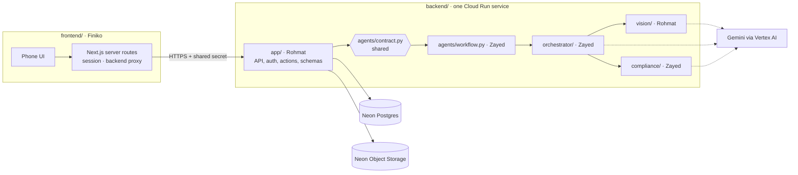
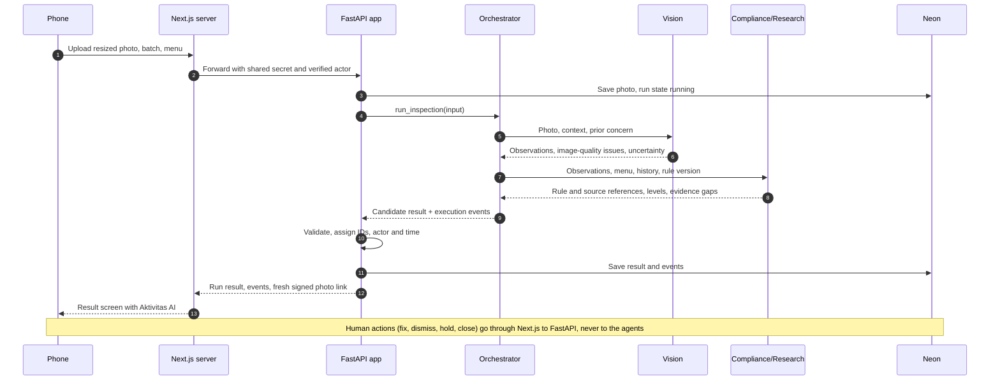
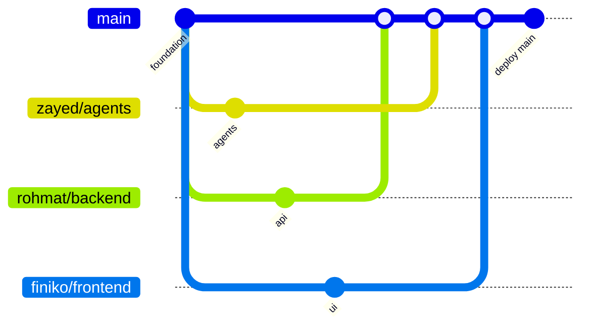

# Development guide

Shared working reference for Dapur Aman: decisions, ownership, contracts and workflow. Setup steps are in the README (Run locally). Updated 21 October 2026.

**How to read the labels:** **Approved** marks project decisions Zayed has approved and recorded; it does not mean every team member has confirmed them. **Proposed (pending team confirmation)** means drafted but not yet agreed; do not build on it as final. **Unverified** means not yet checked against a primary source or a real test. Terms are explained in the [glossary](#8-glossary).

## 1. Status and next actions

**Status (22 Oct):** integrated MVP on `main`. Staff journey works locally: login, photo upload, three ADK agents (Orchestrator, Vision, Compliance), findings with markers and rule references, saved agent activity, human action and retake. Verified with a scripted model in an isolated harness (`frontend/tests/README.md`) and one earlier real Vertex run. Start new work from `main` on your own branch (§6).

| Area | State |
| --- | --- |
| Frontend packages | Bun, lockfile `frontend/bun.lock`; Next.js still runs on Node.js 24 (README) |
| Backend packages | uv, Python 3.13, `backend/uv.lock` |
| Neon | Project, private photo bucket and credentials configured and tested |
| Vercel | Production deploys from `main` (dapur-aman.vercel.app); login waits for the backend URL |
| Vertex AI | Verified locally with the organizer project |
| Cloud Run | Blocked: the build service account needs `roles/run.builder` and `roles/aiplatform.user` from the organizer |

**Next actions**

1. Zayed shares any remaining organizer requirements from the seminar; check them against this guide.
2. Team confirms everything marked *proposed*: ownership (§3), branch workflow (§6), agent-backend interface and analysis approach (§4), first milestone (below). Zayed coordinates.
3. Each developer works on their own branch (§6); Rohmat confirms the backend runs on their machine (Finiko's frontend already runs). Cloud provisioning needs its own authorization.
4. Build the first milestone with the simulated agent result, then replace it with the real three-agent run.

### First milestone (proposed, pending team confirmation)

**Target ~18:00 WIB, 21 October:** a rough end-to-end slice. Deployment by then is a target, not a requirement; working integration and correctness come first.

| # | Who | Task | Depends on |
| --- | --- | --- | --- |
| 1 | Zayed + Rohmat | Agree `backend/agents/contract.py` and example input/output JSON (§4) | — |
| 2 | Zayed | Done. Foundation only (target 30 minutes): `frontend/` and `backend/` skeletons, `pyproject.toml` and `uv.lock`, contract stub. Verify startup and build, push to `main`, create the branches from that commit (§6), hand over `frontend/` to Finiko and the dependency files to Rohmat | 1 |
| 3 | Zayed | Done: Neon project, photo bucket and credentials configured and tested. Remaining: give Rohmat the Dapur Aman credentials. Never delays the task 2 handoffs | — |
| 4 | Rohmat | FastAPI: shared-secret check, login against seeded accounts, upload, run endpoint calling `run_inspection`, saving run, events and photo, one human action | 1, 2, 3; 6 (simulated result) for the run endpoint |
| 5 | Rohmat | Vision agent behind the contract | 1, 2 |
| 6 | Zayed | During integration, after the foundation: simulated `run_inspection` (`fixture`) in `workflow.py`. Then the Orchestrator and Compliance/Research agents, replacing the simulated result | 1, 2 |
| 7 | Finiko | Login and sessions, backend proxy, upload with phone-side resize, loading state, result screen with Aktivitas AI, one human action. Uses example JSON until generated types exist | 2 |
| 8 | Rabab | First staged scenario (one menu): reference tray, normal tray, deliberate visible concern, unclear or cropped photo, corrective retake. Then 5–8 source-linked rule candidates | — |
| 9 | Zayed | Vercel is configured; Cloud Run after the Google Cloud project arrives and authorization. Deploy the approved `main` once owners have verified their parts | 4, 7 |

**Milestone accepted when:** a seeded user logs in, uploads a photo, the backend returns a validated result (simulated, labelled as such), the result screen shows it, one human action is recorded with actor, time and reason, and run, events, photo and action all reload from Neon after a page refresh.

Expand to 2–3 menus only if time permits.

**MVP:** one-kitchen inspection, three agents, human actions, saved evidence. Later, after validation: multi-kitchen access and evidence exports.

Budget about 14 productive hours per developer; share progress before breaks. Agentic AI quality comes before polish. Selection pitch: **2 minutes**; Rabab drafts the story and test cases early, full slides after functionality works.

## 2. Approved project decisions

### Architecture (do not replace without explicit approval)

Three distinct Google ADK agents in one Python backend and one deployment, not separate services:

| Agent | Role |
| --- | --- |
| Vision | Inspects photos, reports possible visible concerns and uncertainty. Method in §4 (proposed) |
| Compliance/Research | Checks findings against menu, history and rules using deterministic tools; flags unsupported conclusions. Retrieval only when justified |
| Orchestrator/Synthesizer | Coordinates both specialists and prepares findings, next steps or retake requests for human review |

- Python enforces safety rules, validation, persistence and every human-controlled state change.
- Safety decisions need human review; supervisor sign-off is not mandatory.
- Photos cannot prove microbiological safety. "No visible concern" never means safe; incomplete analysis never means no concern.

### Stack and hosting

| Area | Decision |
| --- | --- |
| Frontend | `frontend/`: Next.js 16, TypeScript, Tailwind CSS, Material UI, d3. Packages with Bun (`bun.lock`); Next.js runs on Node.js 24. Vercel Hobby |
| Backend | `backend/`: Python 3.13, FastAPI, Google ADK. Cloud Run, Singapore (`asia-southeast1`), subject to organizer requirements. Dependencies with uv (`pyproject.toml`, `uv.lock`) |
| AI provider | Gemini through Vertex AI in our Google Cloud project, initially primary. OpenRouter (through LiteLLM) is the manual alternative. Switch by configuration and redeploy (proposed names `AI_PROVIDER`, `AI_MODEL`) |
| Gemini auth | Local: Application Default Credentials. Cloud Run: service account. No key files. Vertex flag depends on the installed ADK version: `GOOGLE_GENAI_USE_ENTERPRISE` (current docs) or `GOOGLE_GENAI_USE_VERTEXAI` (older). The model location may differ from Singapore |
| Database | Neon Postgres: dedicated Dapur Aman project in Zayed's console-managed Free organization, Singapore |
| Photos | Private Neon Object Storage. The database keeps permanent photo IDs and object keys, never URLs |
| Updates | Refresh after actions plus a refresh button; no realtime |
| Credit | $300 USD Google Cloud credit allocated to the project. Eligible services, quotas and expiry are unverified |

### Request flow and limits

- Browser → Next.js server route → Python as **one waiting call**. Show a loading state while the agents work; show the recorded activity with the result. Add polling or background jobs only if testing shows the waiting call is unreliable.
- The phone resizes photos to JPEG, initially 1600 px on the long edge; test whether this hides small concerns. Python rejects uploads over 4 MB.

Initial limits, final after latency tests:

| Limit | Value |
| --- | --- |
| Whole run (all three agents, tools, retries) | 120 s, then `failed` with a timeout error |
| Each model call (upper bound, not an expected duration) | 45 s |
| Automatic retries | One, only for schema-invalid output. Provider and tool failures are not retried |
| Next.js wait | 150 s |

The normal demo response should be much faster. A timed-out or incomplete run ends as `failed`, never as successful.

### Security and access

Suitable for a controlled hackathon demo, not a claim of production-ready authentication.

| Concern | Decision |
| --- | --- |
| Accounts | A few seeded accounts with hashed passwords; roles `kitchen_staff` and `supervisor`. No registration or account-management UI |
| Sessions | Next.js uses signed, secure, httpOnly cookies. Never trust an actor or role sent by the browser. Split of responsibilities in §3 (proposed) |
| Next.js → Python | HTTPS plus a shared secret header on every sensitive endpoint. Python rejects a missing or invalid secret. Next.js forwards only the verified actor ID; Python looks up the role itself |
| Public routes | The secret does not protect Next.js routes: add basic server-side abuse protection and access checks there |
| Permissions | Python enforces them: only supervisors place or lift holds. Configurable, persistent per-account analysis limit |
| Photo viewing | Python checks access, then issues a fresh 10-minute signed link on every result or history load |
| Secrets | Never in Git, logs or shared documents. Shared secret only in Vercel and Cloud Run; backend keys in Secret Manager; other settings in environment variables |
| Neon access | Rohmat gets Dapur Aman database and storage credentials only; no invite to the organization, which holds unrelated projects |

Not used: Neon Auth, Cloud Run IAM/OIDC, permission frameworks, other Neon products.

### Rejected; do not reintroduce

- A single inspection agent (keep all three).
- Supabase (replaced by Neon); frontend on Cloud Run (replaced by Vercel).
- Automatic AI fallback, model routing, provider-selection UI, a fixed Qwen-VL commitment.
- A ten-minute pitch (now 2 minutes) or any schedule other than §7.

## 3. Team ownership and boundaries (proposed, pending team confirmation)

This replaces the earlier proposal (Zayed on all three agents, Rohmat on the backend only). It is not final until Rohmat and the team confirm it.

| Person | Owns |
| --- | --- |
| Zayed | Foundation setup; Orchestrator and Compliance/Research agents; AI workflow integration and provider configuration; Neon provisioning; Vercel and Cloud Run deployments; integration into `main` |
| Rohmat | Vision agent; FastAPI application features; database operations; photo storage; backend authentication and authorization; human actions |
| Finiko | All frontend code after the handoff, including Next.js server routes, sessions and the backend proxy |
| Rabab | Test scenarios, evidence, demo and presentation; no application code |

### Architecture and file ownership



### Folder ownership

| Path | Owner | Contents |
| --- | --- | --- |
| `backend/pyproject.toml`, `backend/uv.lock` | Rohmat | Dependencies. Zayed asks Rohmat for agent dependency changes |
| `backend/app/` | Rohmat | FastAPI app, endpoints, backend auth and authorization, database, photo storage, human actions |
| `backend/app/schemas/` | Rohmat | HTTP API schemas; the source of the OpenAPI output |
| `backend/agents/contract.py` | **Shared** | Pydantic models for the agent-backend interface (§4); no logic. Breaking changes need both Zayed and Rohmat |
| `backend/agents/workflow.py` | Zayed | Implements `run_inspection`: agent coordination, event capture, simulated mode |
| `backend/agents/providers.py` | Zayed | Provider and model configuration for all three agents |
| `backend/agents/orchestrator/` | Zayed | Orchestrator/Synthesizer agent and prompts |
| `backend/agents/compliance/` | Zayed | Compliance/Research agent, deterministic tools, rule table (rule sources from Rabab) |
| `backend/agents/vision/` | Rohmat | Vision agent and prompts |
| Tests | Owner of the code under test | Agent tests follow the agent's owner; application tests are Rohmat's |
| `frontend/` | Finiko after Zayed's handoff | All UI, Next.js server routes, sessions, backend proxy, generated API types |
| `scenarios/` | Rabab | Staged test photos labelled as test data, scenario sheets, rule sources. No private planning material or secrets |
| Vercel and Cloud Run deployments | Zayed | Only from the approved `main` (§6) |

### Rules

- Zayed and Rohmat agree `contract.py` (§4) before parallel work starts.
- No overlapping file ownership. Ask the owner before editing their files; overlapping frontend ownership only by explicit agreement.
- Zayed verifies the server-to-server security and the deployment configuration during integration.

### Authentication boundary (approved by Zayed, pending team confirmation)

| Side | Owner | Responsibility |
| --- | --- | --- |
| Next.js | Finiko | Login route that passes credentials to FastAPI; signed httpOnly session cookie with a set expiry and `SameSite` protection; basic request-origin checks; backend proxy |
| FastAPI | Rohmat | Credential verification against password hashes, actor lookup, role permissions |
| Integration | Zayed | Verifies the secret, headers, cookie settings and deployment configuration |

1. **Login:** Next.js forwards username and password to FastAPI (with the shared secret). FastAPI verifies them and returns the actor ID, name and role, or a rejection. Next.js never checks passwords or holds hashes.
2. **Each request:** Next.js validates the session, then forwards only the actor ID plus the server-side shared secret. The role in the session is for display only.
3. **FastAPI:** rejects a missing or invalid secret, retrieves the actor's role from its own records and enforces permissions.
4. **Never** trust actor headers or roles supplied by the browser; Next.js sets the actor header itself, from the session.
- Separate clones; give your coding agents these boundaries.
- **Frontend handoff:** Zayed verifies startup and build, pushes the foundation, and shares the run steps. Finiko pulls, confirms startup, then owns `frontend/`.

## 4. Integration contracts

**Approved (v1):** the run result, error, human actions, finding and batch states, and activity events below. **Provisional:** evidence-box coordinates and spatial fields, finalized through implementation testing. **Proposed:** the agent-backend interface and the analysis approach.

- Pydantic models are the source of truth. Frontend types are generated from FastAPI's OpenAPI output (built from `backend/app/schemas/`); nobody edits the generated file by hand. Agreed example JSON may be used meanwhile.
- Change schemas only with the affected owners' agreement; add fields only when implementation or testing needs them.
- The backend assigns persistent IDs, verified actors and UTC timestamps. Agents only propose observations and actions.
- Provider responses stay in the backend; the frontend never parses them. Both providers must produce the same validated result.

### Agent-backend interface (proposed)

One in-process Python call, `run_inspection(InspectionInput) -> InspectionOutcome`, async if ADK needs it. `backend/agents/contract.py` defines the shared models below; `backend/agents/workflow.py` implements `run_inspection`. The backend calls `workflow.run_inspection` and uses only the models from `contract.py`.

| Model | Contents |
| --- | --- |
| `InspectionInput` | Photo, menu and its optional reference tray photo (looked up by the backend from the menu reference), batch history, rule-table version, prior concern when retaking |
| `VisionObservation` | Vision's output to the Orchestrator (fields in the boundary table below). Lives in the contract because Vision and the Orchestrator have different owners |
| `InspectionOutcome` | Validated candidate run result (state, outcome, findings, uncertainty, next action, error), the actual execution events, provider and model |

Agents never touch the database or HTTP. The backend handles persistence, authentication and human actions.

### Photo inspection workflow



### Analysis approach (proposed)

- Vision always inspects for possible visible concerns, with approximate boxes where reliable; otherwise the location is marked unknown.
- When a menu has a reference tray photo, Vision also compares food components semantically (present, missing, different), not by exact visual matching. Without a reference, inspection works normally.
- Never claim precise portion weights, pathogen detection or confirmed food safety.
- Keep reference comparison lightweight; if it adds significant complexity or fails testing, keep detection only.

### Boundaries

| Boundary | Input | Output |
| --- | --- | --- |
| Frontend → backend | Multipart upload: `batch_id`, photo, menu reference; optional `retake_of_photo_id`, linked finding IDs | One run result or a structured error |
| Orchestrator → Vision | Photo, inspection context, prior concern when retaking | Observations: concern/type, evidence box (provisional), explanation, uncertainty; image-quality issues; missing evidence |
| Orchestrator → Compliance/Research | Vision observations, menu, batch history, rule-table version | Per observation: rule/source references, level, evidence gaps, recommended action, actual tool references |
| Backend ↔ storage | Photo and run data, events, findings, human actions | Saved references or an explicit storage failure |
| Backend → activity view | Run reference | Ordered events plus current run state |

**Run result**

| Field | Meaning |
| --- | --- |
| `run_id`, `batch_id`, `photo_id` | Backend-assigned references |
| `state` | `running`, `completed` or `failed` |
| `outcome` | Only when completed: `no_visible_concern`, `review_required` or `retake_required` |
| `findings` | Each links photo/observation, box (provisional), level/type, explanation, verified rule/source or evidence gap, suggested action |
| `uncertainty`, `next_action` | What the agents could not determine; the suggested next step |
| `events` | Activity events for this run (below) |
| `error` | Only when failed (below) |

The backend also records provider, model and rule version with each run.

**Error:** `code`, safe `message`, `stage`, `retryable`. Stages distinguish input, provider/agent, rule, validation, timeout and storage. `retryable` tells the user whether trying again may help; it does not trigger automatic retries (§2). A failed save is not a saved action.

**Coordinates (provisional):** image-relative `[x_min, y_min, x_max, y_max]`, normalized 0–1, validated in Python; a missing box stays explicit.

**Human actions:** each records finding or batch ID, action, required reason and evidence reference; the backend adds verified actor and time.

| Finding state | Rule |
| --- | --- |
| `open` | Default. AI re-analysis never clears it |
| `fixed` | Needs a correction note and retake evidence |
| `dismissed` | Needs a reason |

| Batch state | Rule |
| --- | --- |
| `in_review` | Default |
| `on_hold` | Placed or lifted by a supervisor, with a reason |
| `closed` | Only with no open findings and no active hold. Closing does not certify the food as safe |

**Activity events:** saved with each run as structured JSON in Neon and returned with the result. Shown in an expandable "Aktivitas AI" section below the result and with the run history. Human actions keep their own records and appear alongside.

- Fields: event and run IDs, per-run sequence, timestamp, step and optional parent step, agent or actor, kind and status, safe summary, photo/finding/rule/tool-call references, uncertainty or error.
- Record only actual agent, tool and application execution plus human actions. Never private reasoning, secrets or invented progress.
- Integration-test runs use simulated results recorded with provider `fixture` and labelled "Simulated" in the UI. Never present them as genuine ADK execution.
- Missing records show as incomplete. Failed retries keep earlier results. A separate events table may come later if needed.

## 5. Pending decisions and blockers

| Item | Needed | Who |
| --- | --- | --- |
| Team confirmation | Ownership and folders (§3), branch workflow (§6), agent-backend interface and analysis approach (§4), first milestone (§1) | Team; Zayed coordinates |
| Rabab's contribution | How `scenarios/` reaches `main` and how her authorship is credited. Proposed default, not approved: Rabab prepares the material, Zayed integrates it and credits her accurately in the commit message; no permanent Rabab branch. Never attribute a commit to someone who did not author it | Team |
| Organizer requirements | Remaining seminar information; do not assume there are none | Zayed |
| Demo data | Staged photos labelled as test data; no claim of real kitchen validation | Rabab |
| Models and runtime | Exact Gemini model and location, OpenRouter model; image input, tools and structured output on Python 3.13 across all three agents; both providers on identical cases, including invalid output and tool failure; latency against the §2 limits | Zayed; Rohmat for Vision |
| Google Cloud | The organizer's Google Cloud project and credits are delayed; Cloud Run and Vertex AI wait for them. Then: whether the $300 covers Vertex AI and Cloud Run; quotas, expiry, billing | Organizers, then Zayed |
| Vercel deploy | Verify the first production deployment from `main` | Zayed |
| Vercel author check | Whether Vercel Hobby deploys commits authored by someone other than the Vercel account owner (Zayed). Pass: a preview deploy of `finiko/frontend` succeeds. If not, Zayed deploys manually | Zayed |
| Activity mapping | Map actual ADK and tool events to the event fields | Zayed and Rohmat |
| Rules | Start with 5–8 source-linked rules, each marked verified, pending verification or demo assumption. Qualified review pending; checks never certify food as safe. Decide later whether retrieval is needed | Zayed, sources from Rabab |
| Organizers | Required stack, credits and quotas, final judging weights (25% Agentic AI is provisional), freeze-recording procedure | Team |
| Technical PIC | Who approves post-freeze execution fixes (§7). Proposed default, not approved: Zayed coordinates technical integration and the freeze, subject to organizer and team confirmation | Team |
| Action permissions | Which roles may mark findings fixed or dismissed and close a batch. Approved: only supervisors place or lift holds. Proposed default, not approved: kitchen staff and supervisors may fix, dismiss and close eligible batches | Team; Rohmat implements |
| Commercial | Payer, budget, willingness to pay, revenue model, costs. No customers or revenue yet; billing is outside the MVP | Rabab |

## 6. Git and deployment workflow

### Branches (proposed, pending team confirmation)

One development branch per developer replaces the earlier direct-to-`main` plan once the team confirms it.

| Branch | Owner | Purpose |
| --- | --- | --- |
| `main` | Zayed integrates | Reviewed, tested integration; the only source for production deployments |
| `zayed/agents` | Zayed | Orchestrator, Compliance/Research, workflow, providers |
| `rohmat/backend` | Rohmat | `backend/app/`, Vision agent, dependency files |
| `finiko/frontend` | Finiko | `frontend/` |

Rabab's contribution workflow is still open (§5).



**Setup (Zayed, once; done 21 October, branches start at `724546d`):**

1. Initialize and verify the foundation; commit and push it to `main`.
2. Create all three branches from that same verified commit, without switching branches in between:
   ```
   git switch main
   git pull --ff-only
   git log -1 --oneline   # must show the verified foundation commit
   git branch zayed/agents
   git branch rohmat/backend
   git branch finiko/frontend
   git push -u origin zayed/agents rohmat/backend finiko/frontend
   ```
3. Announce the foundation commit hash; every branch starts there.

**Daily work (each developer):**

1. First time: `git fetch origin` and `git switch <your-branch>`.
2. Commit small, working changes on your branch only; read `git diff` and stage exact files. Push with `git push`.
3. Update from `main` before asking for integration: `git fetch origin` then `git merge origin/main`. Merge, don't rebase, so pushed history is never rewritten.
4. Tell Zayed when your branch is tested and ready. Integrate regularly, at least at each milestone, to avoid large late merges.

**Integration (Zayed):** `git switch main`, `git pull --ff-only`, `git merge --no-ff origin/<branch>`, run the checks, `git push origin main`, announce. Merges keep each developer's commits and authorship.

**Always:** no force-pushes, no overwritten or discarded work. On conflicts or failures, stop and coordinate with Zayed. Each developer checks their own change; Zayed checks integration and deployment.

### Deployment (approved; "approved `main`" depends on the proposed branch workflow)

| Target | How |
| --- | --- |
| Frontend | Vercel Git integration on the public repo, root `frontend/`. `main` deploys production; pushes to other branches create preview deploys for testing only. Zayed is sole owner and deploys manually (dashboard or CLI) if automatic deploys fail. No Pro plan or extra members |
| Backend | Zayed deploys manually from a clean checkout of the approved `main` (`git switch main`, `git pull --ff-only`): `gcloud run deploy --source backend/ --region asia-southeast1 --timeout 300`. Minimum instances 0 during development, 1 during judging |

**If behind schedule, defer:** retrieval (RAG) expansion, web search, extra agents or models, chart polish, extra screens, realtime. **Keep:** all three agents collaborating, deterministic tools, human review, actual execution records, manual provider configuration, and one tested provider working.

## 7. Official deadlines (WIB)

| When | What |
| --- | --- |
| 21 Oct 2026, 13:00 | Implementation window opens |
| 22 Oct, 13:00 | Freeze code, prompts, provider/model settings, workflow configuration and result-affecting test data; record the frozen commit or tag on `main` |
| 22 Oct, 15:00 | Submit deliverables and the selection deck (2-minute pitch) |
| 23 Oct, 08:15 | Finalists submit final deck and backup demo of the same frozen version |

After the freeze, documentation and presentation work may continue. Execution fixes need approval from the technical PIC and a change record; no new features or capabilities.

## 8. Glossary

| Term | Meaning |
| --- | --- |
| MBG | Makan Bergizi Gratis, Indonesia's free nutritious meals programme |
| ADK | Google Agent Development Kit, the Python framework for the three agents |
| Aktivitas AI | "AI activity": the result screen section listing recorded agent, tool and human events |
| Simulated / `fixture` | A stand-in agent result for integration tests; always labelled, never shown as a real AI run |
| Batch | A unit of prepared food reviewed together, with its photos, findings, human actions and state (§4) |
| Hobby | Vercel's free plan |
| RAG | Retrieval-augmented generation: looking up documents to support an answer |
| PIC | Person in charge |
| WIB | Western Indonesia Time, UTC+7 |
