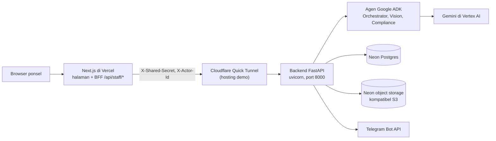
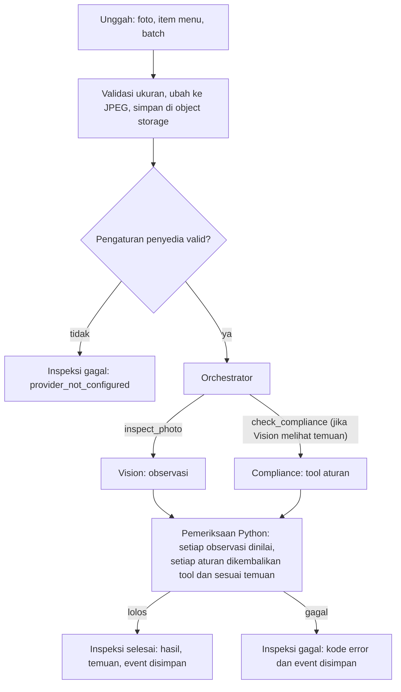
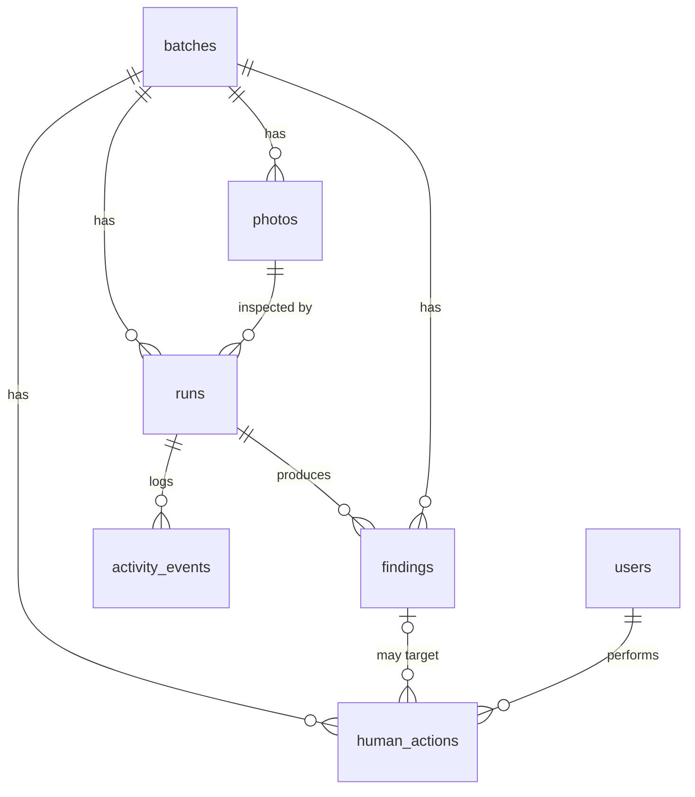

# Dapur Aman by Nexara

[English](README.md)

Asisten keamanan pangan berbasis ponsel untuk dapur MBG (Makan Bergizi Gratis). Staf dapur memotret baki makanan sebelum dikemas. Tiga agen Google ADK mencari temuan yang terlihat dan mencocokkannya dengan tabel aturan. Setiap keputusan tetap diambil oleh manusia.

Dibuat oleh tim **Nexara Vision** untuk **Agentic AI Hackathon 2026**, bagian dari ITB Hackathon Series 2026 (21–23 Oktober 2026).

> **Bukan sertifikat keamanan pangan.** Foto hanya dapat menunjukkan masalah yang terlihat. Aplikasi ini tidak pernah menyatakan makanan aman, dan setiap aturan di dalamnya adalah asumsi demo tanpa rujukan regulasi (lihat [Aturan](#aturan)). Data sekolah, staf, dan menu dalam demo bersifat sintetis.

Demo langsung: https://dapur-aman.vercel.app (lihat [Deployment](#deployment) untuk cara backend di-hosting).

## Daftar isi

- [Ringkasan](#ringkasan)
- [Fitur](#fitur)
- [Arsitektur](#arsitektur)
- [Teknologi](#teknologi)
- [Alur kerja](#alur-kerja)
- [Agen AI](#agen-ai)
- [Frontend](#frontend)
- [Backend dan API](#backend-dan-api)
- [Database dan penyimpanan](#database-dan-penyimpanan)
- [Deployment](#deployment)
- [Konfigurasi](#konfigurasi)
- [Menjalankan secara lokal](#menjalankan-secara-lokal)
- [Pengujian](#pengujian)
- [Keamanan dan pengawasan manusia](#keamanan-dan-pengawasan-manusia)
- [Keterbatasan yang diketahui](#keterbatasan-yang-diketahui)
- [Pemecahan masalah](#pemecahan-masalah)
- [Struktur proyek](#struktur-proyek)
- [Tim](#tim)

## Ringkasan

Dapur MBG mengemas banyak baki dalam waktu singkat, sering kali sebelum subuh. Memeriksa setiap baki dengan mata itu sulit, dan kesalahan mudah terlewat. Dapur Aman memberikan pemeriksaan kedua untuk setiap foto dan mencatat apa yang ditandai, siapa yang menanganinya, dan alasannya.

| Yang dilakukan AI | Yang tidak dilakukan AI |
| --- | --- |
| Membaca foto dan mendaftar kemungkinan temuan, dengan kotak penanda pada foto jika lokasinya dapat ditentukan | Memutuskan bahwa makanan aman |
| Mencocokkan setiap temuan dengan aturan di tabel aturan, atau menyatakan tidak ada aturan yang berlaku | Menandai temuan sebagai diperbaiki atau diabaikan |
| Mencatat hal yang tidak dapat dilihatnya (ketidakpastian, kekurangan bukti, kualitas gambar) | Menahan batch atau mencabut penahanan |
| Mengusulkan hasil dan satu langkah berikutnya untuk staf | Menutup batch atau mengirim laporan ke sekolah |

Setiap tindakan yang mengubah temuan atau batch melewati endpoint tindakan manusia, yang tidak pernah dipanggil oleh agen. Sebuah tes backend memeriksa hal ini (`test_ai_never_closes_batch_or_resolves_findings`).

## Fitur

| Fitur | Fungsi |
| --- | --- |
| Login berdasarkan peran | Akun staf dan supervisor. Setelah login, supervisor diarahkan ke `/dashboard` dan staf ke `/staff`, sesuai peran yang dikembalikan backend. |
| Batch baru dari foto | Staf mengisi nama meja atau jalur, komponen menu, dan sekolah tujuan, lalu mengambil atau memilih foto. |
| Persiapan foto | Browser menerima JPEG, PNG, atau WebP hingga 20 MB dan mengubah ukurannya menjadi sisi terpanjang 1600 px dalam format JPEG. Server menolak file di atas 4 MB dan menyimpan setiap foto sebagai JPEG. |
| Tag menu | Komponen menu diketik sebagai tag (Enter atau koma menambah satu tag; duplikat tanpa membedakan huruf besar-kecil dilewati). Vision memeriksa foto terhadap tag ini. Foto ulang memakai menu batch. |
| Penanda progres AI | Menampilkan tiga tahap (Orkestrator, Vision, Kepatuhan) selama inspeksi berjalan. Tahapan ini berbasis waktu, bukan status langsung dari server. |
| Foto bertanda | Kotak bernomor di atas setiap temuan. Mengetuk nomor akan menuju temuan tersebut. |
| Daftar temuan | Tingkat (keamanan atau kualitas), penjelasan, rujukan aturan, kekurangan bukti, dan tindakan yang disarankan untuk setiap temuan. |
| Keputusan atas temuan | "Sudah diperbaiki" atau "Abaikan dengan alasan". Pilihan diperbaiki hanya tersedia setelah ada foto ulang yang lebih baru dan sudah selesai diperiksa. |
| Foto ulang | "Periksa foto ulang" menambahkan foto baru ke batch yang sama. Temuan sebelumnya tetap menyimpan keputusan manusia; AI tidak pernah menghapusnya. |
| Penghitung waktu penyimpanan | Waktu sejak foto pertama batch terhadap batas demo 4 jam. Berwarna kuning pada 30 menit terakhir dan merah setelah batas terlewati. |
| Dasbor supervisor | Ringkasan angka, temuan keamanan terbuka terbaru, daftar batch yang dapat difilter, dan status per sekolah. Khusus supervisor. |
| Tahan dan cabut penahanan | "Tahan batch" dan "Cabut penahanan", masing-masing dengan alasan. Khusus supervisor. |
| Tutup batch | "Tutup batch" muncul jika batch tidak sedang ditahan, tidak ada temuan terbuka, dan inspeksi terakhir selesai tanpa meminta foto ulang. |
| Laporan ke sekolah via Telegram | "Laporan Pemeriksaan Batch" untuk kontak sekolah. Dikirim saat supervisor menutup batch, atau atas permintaan supervisor untuk batch yang sudah ditutup. |
| Peringatan supervisor via Telegram | Peringatan keamanan saat foto pertama memiliki temuan, dan pesan saat foto ulang menunjukkan temuan atau tidak ada masalah terlihat. |
| Aktivitas AI tersimpan | "Aktivitas AI tersimpan" mencantumkan langkah agen dan tool yang tercatat untuk setiap inspeksi. |
| Riwayat tindakan manusia | "Riwayat tindakan manusia" mencantumkan siapa melakukan apa pada batch, kapan, dan alasannya. |

Belum diimplementasikan: verifikasi QR untuk baki atau laporan. Tidak ada kode QR di frontend maupun backend.

## Arsitektur



- Browser hanya berkomunikasi dengan aplikasi Next.js pada origin yang sama. Route backend-for-frontend (BFF) di `/api/staff/*` menyimpan cookie sesi dan menambahkan shared secret yang hanya ada di server.
- Backend memeriksa shared secret di setiap route data dan memuat pengguna yang bertindak dari `X-Actor-Id`, yang diambil BFF dari sesi bertanda tangan, bukan dari browser.
- Foto disimpan di object storage; batch, inspeksi, temuan, event, dan tindakan manusia disimpan di Postgres.

## Teknologi

| Lapisan | Teknologi |
| --- | --- |
| Frontend | Next.js 16.4 (App Router), React 19.3, TypeScript 5, MUI 9, Tailwind CSS 4, d3 7 |
| Package manager | Bun 1.4+ (`frontend/bun.lock`); Next.js berjalan di Node.js 24 |
| Backend | Python 3.13, FastAPI 0.141, SQLAlchemy 2.1, psycopg 3, Pydantic 2, uvicorn |
| AI | Google ADK 2.12, Gemini melalui Vertex AI; OpenRouter melalui LiteLLM sebagai alternatif manual |
| Data | Neon Postgres; Neon object storage melalui boto3 (API S3) |
| Gambar | Pillow (konversi dan validasi JPEG) |
| Autentikasi | Hash kata sandi bcrypt; cookie sesi bertanda tangan HMAC |
| Notifikasi | Telegram Bot API |
| Hosting | Vercel (frontend); backend di laptop melalui Cloudflare Quick Tunnel untuk demo |
| Perkakas | uv (Python), ESLint, pytest |

## Alur kerja

### Staf

1. Masuk dengan akun staf. Aplikasi membuka daftar batch di `/staff`.
2. Mulai batch: pilih sekolah, ketik nama meja atau jalur, periksa tag menu, lalu ambil atau pilih foto.
3. Kirim dan tunggu hingga penanda progres selesai. Jangan mengirim ulang selama proses berjalan.
4. Layar peninjauan terbuka. Baca hasil inspeksi dan penghitung waktu penyimpanan. Hasil "tidak ada masalah terlihat" tetap meminta pemeriksaan manusia.
5. Periksa foto bertanda dan setiap temuan. Untuk temuan yang perlu diperbaiki, perbaiki baki, lalu unggah foto baru melalui "Periksa foto ulang".
6. Setelah foto ulang selesai diperiksa, tandai temuan "Sudah diperbaiki" dengan alasan. Sebelum itu, pilihan tersebut bertuliskan "Sudah diperbaiki (perlu foto ulang)" dan tidak dapat dipilih. Temuan juga dapat diabaikan dengan alasan kapan saja.
7. Jika batch tidak sedang ditahan, tidak ada temuan terbuka, dan inspeksi terakhir selesai tanpa meminta foto ulang, periksa baki secara langsung lalu tekan "Tutup batch".

### Supervisor

1. Masuk dengan akun supervisor. Aplikasi membuka `/dashboard`. Peran lain mendapat pesan khusus supervisor; backend mengembalikan 403.
2. Baca ringkasan angka (temuan keamanan, diperbaiki oleh staf, diabaikan, masih terbuka) dan temuan keamanan terbuka terbaru.
3. Tahan batch dengan "Tahan batch" pada kartu temuan dan alasan (minimal 3 karakter).
4. Filter batch berdasarkan semua, terbuka, ditahan, atau ditutup. Cabut penahanan dengan "Cabut penahanan" dan alasan.
5. Buka batch mana pun dengan "Periksa baki" untuk meninjaunya seperti staf.
6. Untuk batch yang sudah ditutup, kirim laporan ke sekolah dengan "Kirim laporan Telegram" (dasbor) atau "Kirim laporan ke Telegram sekolah" (layar peninjauan).

### Aturan keputusan

| Keputusan | Siapa | Aturan yang ditegakkan backend |
| --- | --- | --- |
| Menandai temuan diperbaiki | Staf atau supervisor | Memerlukan alasan dan inspeksi lebih baru yang selesai dalam batch yang sama; jika tidak, 409. |
| Mengabaikan temuan | Staf atau supervisor | Memerlukan alasan. Tidak perlu foto ulang. |
| Menahan atau mencabut penahanan | Khusus supervisor | Memerlukan alasan; staf mendapat 403. |
| Menutup batch | Semua pengguna yang sudah masuk | Ditolak (400) selama masih ada temuan terbuka atau batch sedang ditahan. |
| Mengirim laporan ke sekolah | Khusus supervisor | Batch harus sudah ditutup (jika tidak, 409). Dikirim otomatis hanya saat supervisor yang menutup batch. |

Alasan minimal 3 karakter (aplikasi juga membatasinya hingga 2000). Penahanan mencegah penutupan batch, tetapi tidak mencegah foto baru atau keputusan atas temuan.

### Status batch dan inspeksi

| Nilai | Arti |
| --- | --- |
| Batch `in_review` | Batch terbuka (bawaan saat dibuat) |
| Batch `on_hold` | Supervisor menahan batch |
| Batch `closed` | Ditutup oleh manusia |
| Hasil inspeksi `clean` | Tidak ada masalah terlihat. Ini tidak membuktikan makanan aman. |
| Hasil inspeksi `review_required` | Temuan atau ketidakpastian perlu ditinjau manusia |
| Hasil inspeksi `retake_required` | Foto tidak cukup untuk memutuskan; ambil foto baru |
| Status inspeksi `running` | Inspeksi sedang berjalan |
| Status inspeksi `failed` | Inspeksi gagal; tidak ada hasil yang ditampilkan sebagai temuan |

## Agen AI

### Agen dan tanggung jawabnya

| Agen | Dibuat di | Tugas | Tool | Input |
| --- | --- | --- | --- | --- |
| Orchestrator (`orchestrator`) | `backend/agents/orchestrator/agent.py` | Memanggil agen spesialis, memilih hasil, menulis satu langkah berikutnya untuk staf | `inspect_photo`, `check_compliance` | Ringkasan teks: menu, ada tidaknya foto referensi, jumlah temuan sebelumnya, penanda foto ulang. Agen ini tidak melihat gambar. |
| Vision (`vision`) | `backend/agents/vision/adk_agent.py` | Mendaftar temuan yang terlihat dengan kotak ternormalisasi, ketidakpastian, dan catatan kualitas gambar | Tidak ada | Foto, item menu, jenis temuan yang dikenal, foto referensi opsional, dan temuan sebelumnya saat foto ulang |
| Compliance (`compliance`) | `backend/agents/compliance/agent.py` | Mencocokkan setiap observasi Vision dengan satu aturan, atau menyatakan tidak ada yang berlaku | `lookup_rules`, `check_evidence`, `check_batch_history` | Observasi Vision dan riwayat batch dari state sesi. Agen ini tidak melihat gambar. |

Tool Compliance bersifat lokal dan deterministik: membaca tabel aturan dan state inspeksi. Tidak ada pencarian web atau pengambilan data eksternal. Setiap agen berjalan di runner ADK in-memory masing-masing; satu perekam mengumpulkan event dari ketiganya secara berurutan (`backend/agents/workflow.py`).

### Model dan penyedia

- `AI_PROVIDER` memilih `vertex` (Gemini di Vertex AI), `openrouter` (melalui LiteLLM, dengan fallback upstream dinonaktifkan), atau `fixture` (hasil simulasi berlabel untuk tes; tanpa panggilan model).
- `AI_MODEL` menentukan model. Kode penyedia membaca environment secara langsung, sehingga `AI_PROVIDER`, `AI_MODEL`, dan untuk Vertex `GOOGLE_CLOUD_PROJECT` wajib diisi di `backend/.env`. Nilai bawaan di `backend/app/config.py` tidak dipakai saat agen berjalan.
- Agen memakai temperature 0 dan batas 45 detik per panggilan model. Tidak ada pergantian penyedia secara otomatis.

### Siklus inspeksi



1. API menolak foto kosong atau terlalu besar, mengubahnya ke JPEG, dan mengunggahnya ke object storage sebelum ada panggilan model.
2. Orchestrator memanggil Vision, lalu Compliance jika Vision melaporkan temuan.
3. Kode Python memvalidasi kerja agen: Compliance harus menilai setiap observasi, dan setiap aturan yang dirujuk harus dikembalikan oleh tool aturan dalam inspeksi ini serta mencakup jenis temuan tersebut. Compliance tidak dapat merujuk aturan dari ingatan.
4. Python membuat satu temuan per observasi: kotak dan penjelasan dari Vision, tingkat dan rujukan aturan yang cocok, kekurangan bukti dari tool dan Compliance, serta tindakan yang disarankan Compliance. Temuan tanpa aturan yang cocok memakai tingkat bawaan `safety`; jika tidak ada kekurangan bukti lain, catatannya menyatakan tidak ada aturan yang mencakupnya.
5. Orchestrator hanya boleh memilih `no_visible_concern` jika tidak ada temuan, masalah kualitas gambar, atau bukti yang kurang. Jika tidak, inspeksi gagal.
6. Seluruh inspeksi dibatasi 120 detik. Temuan, event, dan inspeksi disimpan; temuan dimulai dengan status `open`.

### Perilaku saat gagal

Inspeksi tidak pernah mengarang hasil. Setiap pemeriksaan yang gagal mengakhiri inspeksi sebagai `failed`, event dan error-nya disimpan, dan API mengembalikan 502 dengan kode error dan ID inspeksi. Hanya balasan agen yang tidak sesuai format JSON yang diulang, satu kali, dengan pesan perbaikan tetap. Error model, timeout, dan kegagalan tool tidak diulang, dan backend tidak memulai inspeksi baru dengan sendirinya.

| Kode error | Kapan |
| --- | --- |
| `provider_not_configured` | Pengaturan AI hilang atau tidak valid |
| `vision_agent_missing` | Modul agen Vision tidak dapat dimuat |
| `unknown_rule_table` | Input menyebut tabel aturan selain `rule-table-v1` |
| `run_timeout` | Inspeksi melewati 120 detik |
| `agent_error`, `model_error` | Panggilan agen atau model menimbulkan atau mengembalikan error |
| `invalid_agent_output`, `empty_reply` | Balasan agen tetap salah format setelah satu perbaikan, atau kosong |
| `vision_not_run`, `compliance_not_run` | Agen spesialis yang diperlukan tidak selesai |
| `assessment_mismatch` | Penilaian Compliance tidak tepat mencakup item yang diamati |
| `unverified_rule`, `rule_mismatch` | Aturan yang dirujuk tidak dikembalikan tool, atau tidak mencakup temuan |
| `unsupported_outcome`, `invalid_outcome` | Hasil yang diusulkan bertentangan dengan temuan atau melanggar kontrak |

### Output

Kontrak bersama ada di `backend/agents/contract.py` (`InspectionOutcome`). Inspeksi yang selesai memiliki `outcome`, `findings`, `uncertainty`, `next_action`, `events`, `provider`, dan `model`. Setiap temuan memiliki `level`, `concern_type`, `box` (ternormalisasi 0–1 atau null), `explanation`, `rule_reference`, `evidence_gap`, dan `suggested_action`.

Event aktivitas dicatat dari callback ADK yang benar-benar terjadi: panggilan agen, panggilan tool, panggilan model yang gagal, perbaikan format satu kali, dan langkah simulasi pada mode fixture. Setiap event memiliki nomor urut, waktu, agen, langkah, status, dan ringkasan. `backend/agents/examples/inspection_outcome.json` adalah contoh sintetis, bukan output nyata.

### Aturan

Tabel aturan adalah `rule-table-v1` di `backend/agents/compliance/rules.py`. Bentuk rujukannya seperti `rule-table-v1:foreign-01`.

| Aturan | Tingkat | Jenis temuan | Status |
| --- | --- | --- | --- |
| `foreign-01` | keamanan | benda asing, rambut, serangga, pecahan kemasan, ulat, cacing, larva, hama, bahaya fisik | asumsi demo |
| `cooking-01` | keamanan | kurang matang, tampak mentah | asumsi demo |
| `spoilage-01` | keamanan | basi, jamur, perubahan warna | asumsi demo |
| `menu-01` | kualitas | komponen hilang atau berbeda, sekat kosong, menu tidak sesuai | asumsi demo |
| `portion-01` | kualitas | porsi kurang (tiga varian) | asumsi demo |
| `presentation-01` | kualitas | penyajian tidak rapi atau berantakan, baki kotor, masalah penyajian | asumsi demo |

**Aturan terverifikasi dan asumsi demo.** Belum ada aturan yang didukung sumber: setiap aturan memiliki `source: None` dan status `demo_assumption` hingga tim menautkan sumbernya. Batas waktu penyimpanan 4 jam juga merupakan asumsi demo, dan diberi label demikian di layar. Aturan hanya menyatakan temuan terlihat mana yang memerlukan pemeriksaan manusia apa; aturan tidak pernah menyatakan makanan aman.

## Frontend

### Halaman

| Route | Isi |
| --- | --- |
| `/` | Mengarahkan ke `/staff` |
| `/landing` | Halaman landing statis dengan tautan ke login dan dasbor |
| `/login` | Formulir nama pengguna dan kata sandi; mengarahkan sesuai peran setelah login |
| `/staff` | Daftar batch staf, formulir batch baru, dan peninjauan batch |
| `/staff-review`, `/staff-send-confirm` | Aplikasi staf dalam mode peninjauan |
| `/supervisor` | Mengarahkan ke `/dashboard` |
| `/dashboard` | Dasbor supervisor (khusus supervisor) |

`frontend/app/sample/*.html` adalah cuplikan prototipe statis yang disimpan sebagai referensi; file ini bukan route aplikasi.

### Komponen dan modul

| File | Fungsi |
| --- | --- |
| `app/components/StaffApp.tsx` | Alur staf: daftar batch, tampilan batch, logout |
| `app/components/StaffShell.tsx` | Kerangka halaman, navigasi staf, pesan error bersama |
| `app/components/Login.tsx` | Formulir login dan pengalihan berdasarkan peran |
| `app/components/UploadForm.tsx` | Unggah batch baru dan foto ulang; pengubahan ukuran foto |
| `app/components/BatchResult.tsx` | Hasil inspeksi, temuan, keputusan, penutupan, laporan, aktivitas, dan riwayat tindakan |
| `app/components/MarkedPhoto.tsx` | Foto dengan kotak temuan bernomor |
| `app/components/MenuTags.tsx` | Input tag komponen menu |
| `app/components/HoldingTimer.tsx` | Waktu berjalan terhadap batas demo 4 jam |
| `app/components/InspectionSteps.tsx` | Penanda progres tiga tahap selama inspeksi |
| `app/components/icons.tsx` | Ikon SVG inline |
| `lib/contracts.ts` | Tipe payload API dan helper browser `api()` untuk `/api/staff/*` |
| `lib/labels.ts` | Label tampilan untuk kode backend |
| `lib/session.ts` | Penandatanganan dan verifikasi token sesi (khusus server) |
| `lib/staff-api.ts` | BFF: validasi, pembatasan laju, panggilan backend (khusus server) |

### Operasi BFF (`/api/staff/<operasi>`)

Route `frontend/app/api/staff/[...path]/route.ts` menerima GET dan POST lalu meneruskannya ke `lib/staff-api.ts`. Respons memakai `Cache-Control: no-store`.

| Metode | Operasi | Panggilan backend | Catatan |
| --- | --- | --- | --- |
| POST | `login` | `POST /api/auth/login` | Tidak perlu sesi. 10 percobaan per nama pengguna per 10 menit. Menetapkan cookie sesi. |
| POST | `logout` | tidak ada | Menghapus cookie |
| GET | `session` | tidak ada | Mengembalikan nama dan peran pengguna yang masuk |
| GET | `overview` | `GET /api/overview` | |
| GET | `schools` | `GET /api/schools` | |
| GET | `supervisor/dashboard`, `supervisor/feed` | `GET /api/supervisor/dashboard`, `/feed` | Backend mengembalikan 403 untuk selain supervisor |
| GET | `batches/{batch_id}` | `GET /api/batches/{batch_id}` | ID harus sesuai `[a-zA-Z0-9_-]{1,64}` |
| GET | `runs/{run_id}/events` | `GET /api/runs/{run_id}/events` | Aturan ID yang sama |
| POST | `actions` | `POST /api/actions` | Memvalidasi tindakan, ID, dan alasan (3–2000 karakter) |
| POST | `notifications/dispatch-report/{batch_id}` | `POST /api/notifications/dispatch-report/{batch_id}` | |
| POST | `inspect` | `POST /api/inspections/upload-and-run` | JPEG, PNG, atau WebP hingga 4 MB. Satu inspeksi sekaligus dan 10 per 10 menit per akun. |

Setiap operasi selain `login` memerlukan cookie sesi yang valid (jika tidak, 401). Setiap POST harus berasal dari origin yang sama (jika tidak, 403). Pembatasan laju dan penjaga satu inspeksi disimpan di memori per instance server.

## Backend dan API

### Modul (`backend/app`)

| File | Tugas |
| --- | --- |
| `main.py` | Aplikasi FastAPI, startup (tabel, migrasi kecil, seeding), CORS, semua route |
| `auth.py` | Pemeriksaan shared secret (constant-time), aktor dari `X-Actor-Id`, helper bcrypt |
| `config.py` | Memuat `backend/.env` dan membaca pengaturan |
| `database.py` | Engine SQLAlchemy, sesi, `get_db` |
| `inspection.py` | Jembatan ke agen: konversi JPEG, penyusunan respons, label hasil |
| `models.py` | Model ORM (lihat [Database dan penyimpanan](#database-dan-penyimpanan)) |
| `notifications.py` | Peringatan Telegram dan laporan ke sekolah |
| `storage.py` | Unggah foto dan URL presigned |
| `seed.py` | Akun dan sekolah bawaan; perintah `--reset-passwords` |
| `schemas/` | Model request dan response Pydantic (auth, action, batch, supervisor, vision) |

`backend/agents/` berisi agen ADK, workflow, dan kontrak bersama.

### Endpoint

Semua route ada di `backend/app/main.py`. "Secret" berarti header `X-Shared-Secret` harus sama dengan `BACKEND_SHARED_SECRET` (401 jika salah, 503 jika backend tidak memilikinya). "Aktor" berarti `X-Actor-Id` harus menyebut pengguna yang dikenal, berdasarkan ID atau nama pengguna (jika tidak, 401).

| Metode | Path | Fungsi | Secret | Aktor | Peran |
| --- | --- | --- | --- | --- | --- |
| GET | `/health` | Pemeriksaan kesehatan | Tidak | Tidak | Publik |
| POST | `/api/auth/login` | Memeriksa nama pengguna dan kata sandi; mengembalikan ID aktor, nama, dan peran | Ya | Tidak | Semua |
| POST | `/api/inspections/upload-and-run` | Menyimpan foto, menjalankan tiga agen, menyimpan inspeksi dan temuan | Ya | Ya | Semua |
| POST | `/api/vision/inspect` | Alias route di atas | Ya | Ya | Semua |
| GET | `/api/overview` | Data beranda staf: ringkasan, menu, batch | Ya | Ya | Semua |
| GET | `/api/batches/overview` | Alias `/api/overview` | Ya | Ya | Semua |
| GET | `/api/supervisor/dashboard` | Data dasbor supervisor | Ya | Ya | Supervisor |
| GET | `/api/supervisor/feed` | Alias route dasbor | Ya | Ya | Supervisor |
| GET | `/api/batches/{batch_id}` | Detail batch: inspeksi, temuan, tindakan, URL foto baru | Ya | Ya | Semua |
| GET | `/api/runs/{run_id}/events` | Event aktivitas tersimpan untuk satu inspeksi | Ya | Ya | Semua |
| GET | `/api/schools` | Sekolah penerima | Ya | Ya | Semua |
| POST | `/api/actions` | Mencatat `fixed`, `dismissed`, `on_hold`, `lift_hold`, atau `close` | Ya | Ya | Semua; `on_hold` dan `lift_hold` khusus supervisor |
| POST | `/api/notifications/test-alert` | Mengirim pesan uji ke chat Telegram supervisor | Ya | Ya | Supervisor |
| POST | `/api/notifications/dispatch-report/{batch_id}` | Mengirim laporan ke sekolah untuk batch yang sudah ditutup | Ya | Ya | Supervisor |

Totalnya 14 path yang dilayani 11 handler. FastAPI juga menyediakan `/docs`, `/redoc`, dan `/openapi.json` (hanya skema, tanpa data).

## Database dan penyimpanan

### Tabel (Neon Postgres, `backend/app/models.py`)

| Tabel | Isi | Relasi |
| --- | --- | --- |
| `users` | Akun staf dan supervisor: nama pengguna, hash bcrypt, nama, peran (`kitchen_staff` atau `supervisor`), telepon, chat Telegram | Dirujuk oleh `human_actions.actor_id` |
| `batches` | Satu batch: menu, nama meja, sekolah tujuan, status, alasan dan pelaku penahanan | Induk dari foto, inspeksi, temuan, tindakan manusia |
| `photos` | Metadata foto dan kunci objek; isi file ada di object storage | `batch_id` → `batches` |
| `runs` | Satu inspeksi AI atas satu foto: status, hasil, judul, langkah berikutnya, ketidakpastian, error, penyedia, model | `batch_id` → `batches`, `photo_id` → `photos` |
| `findings` | Satu temuan dari inspeksi: tingkat, jenis temuan, kotak, penjelasan, status (`open`, `fixed`, `dismissed`), catatan penyelesaian, pelaku, dan waktu | `run_id` → `runs`, `batch_id` → `batches` |
| `activity_events` | Langkah agen dan tool yang berurutan untuk satu inspeksi | `run_id` → `runs` |
| `human_actions` | Setiap keputusan staf atau supervisor beserta alasannya | `batch_id` → `batches`, `finding_id` → `findings` (boleh kosong), `actor_id` → `users` |
| `school_recipients` | Sekolah penerima porsi: nama, kepala sekolah, kontak, jumlah porsi, alamat | Terhubung ke batch melalui string ID (tanpa foreign key) |



**Startup mengubah skema.** Saat mulai, backend menjalankan `create_all` untuk tabel yang belum ada, empat perintah `ALTER TABLE ... ADD COLUMN IF NOT EXISTS`, dan seeding. Tidak ada alat migrasi. Arahkan backend pengembangan ke database terpisah atau branch Neon, jangan sampai ke production secara tidak sengaja.

**Seeding.** `backend/app/seed.py` membuat akun demo `staff1` (`kitchen_staff`) dan `supervisor1` (`supervisor`) serta tiga sekolah sintetis. Kata sandi diambil dari `SEED_STAFF_PASSWORD` dan `SEED_SUPERVISOR_PASSWORD`; tanpa keduanya, seeding akun dilewati. Akun yang sudah ada tetap memakai kata sandinya, tetapi nomor telepon dan chat Telegram-nya diperbarui dari nilai seed setiap kali backend mulai. `uv run python -m app.seed --reset-passwords` (dari `backend/`) mengganti kedua hash.

### Object storage

Foto disimpan di bucket Neon object storage yang privat melalui API S3 (`backend/app/storage.py`), dengan pola `photos/<batch_id>/<photo_id>.jpg`. Aplikasi tidak pernah membuat objek menjadi publik. URL baca presigned dibuat pada setiap permintaan: 10 menit untuk layar aplikasi, 1 jam untuk laporan Telegram ke sekolah.

## Deployment

### Kondisi saat ini

| Bagian | Kondisi |
| --- | --- |
| Frontend | Vercel production di https://dapur-aman.vercel.app, di-deploy otomatis dari `main` |
| Backend (demo) | Berjalan di laptop Windows milik anggota tim (`127.0.0.1:8000`), dibuka melalui Cloudflare Quick Tunnel. `BACKEND_URL` di Vercel mengarah ke tunnel tersebut. |
| Backend (Cloud Run) | Layanan privat pernah di-deploy ke Google Cloud Run (`asia-southeast2`), tetapi tidak dipakai karena batasan IAM di bawah |
| Database dan penyimpanan | Neon Postgres dan Neon object storage |
| AI | Gemini di Vertex AI, dipanggil dari backend |

Demo hanya berfungsi selama laptop menyala dan terhubung ke internet.

### Batasan Cloud Run dan IAM

Frontend sudah mendukung backend Cloud Run yang privat: jika `GCP_INVOKER_CREDENTIALS` berisi kunci service account, BFF membuat Google ID token dengan audience origin `BACKEND_URL` dan mengirimnya sebagai `Authorization`, selain shared secret. Dua izin proyek menghambat pengaturan ini, dan anggota tim tidak dapat mengubah IAM proyek:

1. Service account runtime Cloud Run tidak memiliki peran Vertex AI user (`roles/aiplatform.user`), sehingga panggilan agen akan gagal.
2. Tim tidak dapat membuat kunci service account (`iam.serviceAccountKeys.create`), sehingga Vercel tidak memiliki kredensial untuk membuat ID token.

Keduanya memerlukan tindakan panitia. Sampai saat itu, laptop dan tunnel menjadi backend production.

### Laptop dan Cloudflare Quick Tunnel

Quick Tunnel mendapat URL acak baru `https://<kata>.trycloudflare.com` setiap kali dimulai ulang, sehingga Vercel harus diperbarui dan di-redeploy. Operator memakai launcher lokal di luar repositori ini yang mengotomatiskan langkah di bawah: memakai kembali proses yang sehat, hanya menjalankan yang belum berjalan, memperbarui Vercel hanya jika URL berubah, dan memeriksa bahwa Vercel dapat menjangkau backend.

Langkah manual yang setara:

```sh
# 1. Backend (dari backend/, dengan backend/.env tersedia)
uv run uvicorn app.main:app --host 127.0.0.1 --port 8000
curl http://127.0.0.1:8000/health          # {"status":"ok","service":"dapur-aman-backend"}

# 2. Tunnel (terminal kedua); catat URL trycloudflare.com yang muncul
cloudflared tunnel --no-autoupdate --url http://127.0.0.1:8000

# 3. Hanya jika URL berubah (dari frontend/, yang terhubung ke proyek Vercel)
vercel env update BACKEND_URL production --value https://<kata>.trycloudflare.com --yes
vercel redeploy https://dapur-aman.vercel.app --target production
```

Redeploy memakan waktu sekitar satu menit; selama itu aplikasi tidak dapat menjangkau backend. Untuk memeriksa rantai tanpa menulis data apa pun, kirim login dengan nama pengguna karangan ke `https://dapur-aman.vercel.app/api/staff/login` (dengan header `Origin` yang sesuai): HTTP 401 berarti Vercel menjangkau backend; 502 atau 503 berarti tidak. Hasil 401 tidak membuktikan shared secret cocok, karena backend juga menjawab 401 untuk secret yang salah saat login. Masuk dengan akun asli memeriksa seluruh rantai.

Untuk berhenti, hentikan proses tunnel dan backend (Ctrl+C di setiap terminal). Start berikutnya akan mengganti `BACKEND_URL`.

## Konfigurasi

Hanya nama variabel. Nilai sebenarnya ada di `backend/.env`, `frontend/.env.local`, dan pengaturan proyek Vercel, tidak pernah di Git. Salin `backend/.env.example` dan `frontend/.env.example` sebagai awal.

### Backend

| Nama | Fungsi | Wajib |
| --- | --- | --- |
| `AI_PROVIDER` | `vertex`, `openrouter`, atau `fixture` | Ya |
| `AI_MODEL` | ID model untuk penyedia | Ya, kecuali `fixture` |
| `GOOGLE_CLOUD_PROJECT` | Proyek Google Cloud untuk Vertex AI | Ya untuk `vertex` |
| `GOOGLE_CLOUD_LOCATION` | Lokasi Vertex AI | Disarankan untuk `vertex` |
| `GOOGLE_GENAI_USE_VERTEXAI` | Memberi tahu library Google GenAI untuk memakai Vertex AI | Disarankan untuk `vertex` |
| `OPENROUTER_API_KEY` | Kunci OpenRouter | Hanya untuk `openrouter` |
| `DATABASE_URL` | String koneksi Postgres (`postgresql://` diubah untuk psycopg 3) | Ya |
| `DATABASE_URL_UNPOOLED` | String koneksi langsung; dibaca tetapi saat ini tidak dipakai | Tidak |
| `STORAGE_ENDPOINT`, `STORAGE_REGION`, `STORAGE_BUCKET` | Lokasi object storage | Ya untuk unggah foto |
| `STORAGE_ACCESS_KEY_ID`, `STORAGE_SECRET_ACCESS_KEY` | Kredensial object storage | Ya untuk unggah foto |
| `BACKEND_SHARED_SECRET` | Harus sama dengan nilai frontend; jika kosong, route yang dijaga mengembalikan 503 | Ya |
| `CORS_ALLOWED_ORIGINS` | Origin browser dipisahkan koma; tidak diperlukan untuk alur BFF | Tidak |
| `SEED_STAFF_PASSWORD`, `SEED_SUPERVISOR_PASSWORD` | Kata sandi akun demo hasil seeding | Untuk seeding akun |
| `TELEGRAM_BOT_TOKEN` | Token bot; tanpa ini, pesan hanya ditulis ke log | Tidak |
| `TELEGRAM_CHAT_ID` | Chat cadangan untuk peringatan supervisor dan laporan ke sekolah | Tidak |
| `TELEGRAM_SUPERVISOR_CHAT_ID`, `TELEGRAM_SCHOOL_CHAT_ID` | Chat khusus; memakai `TELEGRAM_CHAT_ID` jika kosong | Tidak |

`SEED_*`, `CORS_ALLOWED_ORIGINS`, dan dua nama chat Telegram khusus dibaca oleh kode tetapi belum tercantum di `backend/.env.example`.

### Frontend

| Nama | Fungsi | Wajib |
| --- | --- | --- |
| `BACKEND_URL` | URL dasar backend; wajib HTTPS kecuali localhost | Ya |
| `BACKEND_SHARED_SECRET` | Dikirim sebagai `X-Shared-Secret`; tidak pernah sampai ke browser | Ya |
| `SESSION_SECRET` | Kunci HMAC untuk cookie sesi; minimal 32 karakter | Ya |
| `GCP_INVOKER_CREDENTIALS` | JSON kunci service account untuk ID token Cloud Run | Hanya untuk backend Cloud Run privat |

## Menjalankan secara lokal

Butuh [Bun](https://bun.sh) 1.4 atau lebih baru, Node.js 24, dan [uv](https://docs.astral.sh/uv/) (uv memasang Python 3.13 sendiri). Bun memasang paket frontend dari `frontend/bun.lock`; jangan pakai npm atau pnpm. Next.js berjalan di Node, jadi `node` harus ada di PATH. Di NixOS, jalankan perintah frontend di dalam `nix shell nixpkgs#nodejs_24`.

1. Salin `backend/.env.example` ke `backend/.env` dan `frontend/.env.example` ke `frontend/.env.local`, lalu isi nilainya. Jangan pernah meng-commit file tersebut. Untuk frontend lokal, isi `BACKEND_URL=http://localhost:8000`.
2. Jalankan backend (http://localhost:8000):

   ```sh
   cd backend
   uv sync
   uv run uvicorn app.main:app --reload --port 8000
   ```

   http://localhost:8000/health seharusnya mengembalikan `{"status":"ok",...}`. Dokumentasi API interaktif ada di http://localhost:8000/docs.
3. Jalankan frontend (http://localhost:3000):

   ```sh
   cd frontend
   bun install --frozen-lockfile
   bun run dev
   ```

4. Hentikan masing-masing dengan Ctrl+C.

Ingat bahwa backend mengubah skema database di `DATABASE_URL` saat mulai (lihat [Database dan penyimpanan](#database-dan-penyimpanan)).

**Model bersama:** `backend/agents/contract.py`; contoh statis ada di `backend/agents/examples/inspection_outcome.json`. Untuk membuat tipe frontend saat backend berjalan: `bunx openapi-typescript http://localhost:8000/openapi.json -o lib/api-types.ts` (di dalam `frontend/`). Jangan pernah mengubah file hasil generate secara manual.

## Pengujian

Tidak ada tes otomatis yang memanggil model berbayar, Neon, object storage, atau Telegram.

**Backend** (dari `backend/`; memakai file SQLite sementara dan balasan model yang sudah diskenariokan):

```sh
DATABASE_URL=sqlite:///./test-tmp.db BACKEND_SHARED_SECRET=test-secret uv run --with pytest --with httpx pytest -q
```

Hasil pada 22 Oktober 2026: 76 lulus. Hapus `test-tmp.db` setelahnya. Tes utama: `tests/agents/test_workflow.py` (alur agen, validasi, dan jalur kegagalan), `tests/agents/test_compliance_tools.py`, `tests/app/test_human_control.py` (AI tidak pernah menyelesaikan temuan atau menutup batch; diperbaiki memerlukan foto ulang), `tests/app/test_notifications.py` (isi laporan, tanpa pengiriman).

Jangan menjalankan `backend/test_vision.py` atau `backend/test_backend_full.py` sembarangan: keduanya skrip manual yang memanggil layanan langsung, dan `test_vision.py` melakukan panggilan model berbayar.

**Frontend** (dari `frontend/`):

| Perintah | Yang diperiksa |
| --- | --- |
| `node --test --test-isolation=none tests/session.test.mjs tests/staff-api.test.cjs` | Penandatanganan sesi dan handler BFF terhadap backend tiruan (lihat `frontend/tests/README.md`) |
| `bun run lint` | ESLint |
| `bunx next typegen` lalu `bunx tsc --noEmit` | TypeScript |
| `bun run build` | Build production |

Untuk alur browser lengkap secara lokal tanpa layanan cloud, `backend/tests/local_mvp_server.py` menjalankan backend in-memory dengan model yang diskenariokan (`uv run --with pytest python tests/local_mvp_server.py` dari `backend/`).

## Keamanan dan pengawasan manusia

- **Secret tetap di server.** Browser hanya memegang cookie sesi httpOnly dan SameSite=Strict (8 jam, ditandatangani HMAC, `Secure` di production). Shared secret dan URL backend hanya ada di server Vercel dan backend.
- **Setiap route data dijaga.** Backend memeriksa shared secret secara constant-time dan mewajibkan aktor yang dikenal; route supervisor memeriksa peran.
- **BFF memvalidasi input** (ID, tindakan, alasan, jenis dan ukuran foto), menolak POST lintas origin, dan membatasi laju login serta inspeksi.
- **Kata sandi** disimpan sebagai hash bcrypt. Kata sandi akun demo berasal dari variabel environment dan tidak ada di repositori.
- **Foto bersifat privat** dan ditampilkan melalui URL presigned berumur pendek.
- **Manusia yang memutuskan.** Agen hanya dapat membuat inspeksi, temuan (berstatus `open`), dan event. Memperbaiki, mengabaikan, menahan, menutup, dan melaporkan adalah tindakan manusia dengan alasan dan pelaku yang tercatat, ditegakkan oleh backend dan dicakup oleh tes.
- **Kegagalan terlihat.** Inspeksi yang gagal atau melewati batas waktu ditampilkan sebagai gagal, tidak pernah sebagai hasil bersih.

## Keterbatasan yang diketahui

- **Bukti hanya dari foto.** Agen tidak dapat memeriksa suhu, bau, tekstur, atau lama penyimpanan, dan foto tidak dapat menunjukkan keamanan mikrobiologis. Output bisa salah; temperature 0 mengurangi variasi tetapi tidak membuat output benar.
- **Aturan masih asumsi demo.** Belum ada aturan yang ditautkan ke regulasi, dan batas waktu penyimpanan 4 jam belum diverifikasi.
- **Waktu penyimpanan dihitung dari foto pertama.** Penghitung waktu, footer dasbor, dan batas waktu di laporan ke sekolah menghitung batas demo 4 jam dari foto pertama batch, bukan dari selesai memasak, sehingga waktu sebenarnya sejak selesai memasak bisa lebih lama.
- **Semua pengguna yang sudah masuk dapat menutup batch.** Laporan ke sekolah hanya dikirim otomatis saat supervisor yang menutup.
- **Penahanan hanya mencegah penutupan.** Penahanan tidak mencegah foto baru atau keputusan atas temuan.
- **Hanya Vision yang melihat foto.** Agen Orchestrator dan Compliance bekerja dari teks Vision.
- **Hosting demo.** Backend bergantung pada satu laptop dan Quick Tunnel; setiap restart tunnel memerlukan pembaruan Vercel dan sekitar satu menit downtime untuk redeploy. Cloud Run terhambat IAM.
- **Batasan di memori.** Pembatasan laju BFF dan penjaga satu inspeksi direset saat restart dan tidak dibagi antar-instance Vercel. Sesi tidak dapat dicabut sebelum kedaluwarsa.
- **Tidak ada migrasi.** Perubahan skema berjalan saat backend mulai.
- **Verifikasi QR belum diimplementasikan.**
- `backend/agents/vision/agent.py` dan `prompts.py` adalah jalur Vision lama yang tidak dipakai oleh workflow inspeksi.

## Pemecahan masalah

| Gejala (pesan yang tampil) | Kemungkinan penyebab | Solusi |
| --- | --- | --- |
| "Koneksi backend belum dikonfigurasi." | `BACKEND_URL` atau `BACKEND_SHARED_SECRET` belum diisi di frontend | Isi keduanya (Vercel atau `frontend/.env.local`); redeploy |
| "Backend memerlukan koneksi HTTPS." | `BACKEND_URL` memakai `http://` pada host non-lokal | Pakai URL tunnel atau layanan `https://` |
| "Sesi belum dikonfigurasi. Isi SESSION_SECRET di server (minimal 32 karakter)." | `SESSION_SECRET` kosong atau terlalu pendek | Isi nilai acak minimal 32 karakter; redeploy |
| "Nama pengguna atau kata sandi salah." padahal kata sandi benar | Shared secret frontend dan backend berbeda (login 401), atau akun demo belum pernah di-seed | Samakan `BACKEND_SHARED_SECRET` di kedua sisi; isi `SEED_*` dan restart backend |
| "Backend menolak kunci server. Periksa BACKEND_SHARED_SECRET." | Shared secret tidak cocok pada route data | Sama seperti di atas |
| "Login backend belum tersedia." atau "Permintaan gagal. Coba lagi atau periksa koneksi server." saat login | Backend mati, tunnel putus, atau `BACKEND_URL` masih mengarah ke tunnel lama | Periksa `/health` secara lokal dan melalui tunnel; perbarui `BACKEND_URL` lalu redeploy |
| "Koneksi backend terputus atau melewati batas waktu. ..." | Backend tidak terjangkau atau panggilan melewati 150 detik | Periksa tunnel; muat ulang batch untuk melihat hasil tersimpan sebelum mencoba lagi |
| "Backend belum dapat menyelesaikan permintaan. ..." | Backend 5xx: error database, secret belum diisi di backend, atau unggah foto ke object storage gagal | Periksa log backend, `backend/.env`, dan nilai `STORAGE_*` |
| "Sesi berakhir. Silakan masuk kembali." (dasbor: "Sesi berakhir. Masuk kembali untuk membuka dasbor.") | Cookie berumur lebih dari 8 jam, atau `SESSION_SECRET` berubah | Masuk kembali |
| "Akun Anda tidak berwenang untuk tindakan ini. Hanya supervisor yang dapat melakukannya." | Akun staf melakukan tindakan supervisor | Sesuai harapan; pakai akun supervisor |
| "Dasbor ini hanya untuk supervisor. Masuk dengan akun supervisor untuk melihatnya." | Akun staf membuka `/dashboard` | Sesuai harapan; pakai akun supervisor |
| Inspeksi gagal dengan `provider_not_configured` | `AI_PROVIDER`, `AI_MODEL`, atau `GOOGLE_CLOUD_PROJECT` belum diisi | Isi di `backend/.env`; restart backend |
| URL tunnel baru tidak ter-resolve di laptop | DNS lokal lambat mengenali nama `trycloudflare.com` baru | Uji melalui resolver publik, misalnya `nslookup <host> 1.1.1.1`, atau `curl --resolve` |
| "Cloud Run menolak permintaan server. ..." atau "Token Cloud Run tidak dapat dibuat. ..." | `GCP_INVOKER_CREDENTIALS` diisi tetapi tidak valid atau tanpa akses invoker | Hapus variabel tersebut kecuali backend berada di Cloud Run |

## Struktur proyek

```text
dapur-aman/
├── backend/
│   ├── agents/
│   │   ├── orchestrator/agent.py   Agen Orchestrator
│   │   ├── vision/adk_agent.py     Agen Vision (agent.py, prompts.py: jalur lama, tidak dipakai)
│   │   ├── compliance/             Agen Compliance, tool, tabel aturan
│   │   ├── workflow.py             run_inspection: menjalankan dan memvalidasi agen
│   │   ├── contract.py             Kontrak inspeksi bersama
│   │   ├── providers.py            Vertex AI, OpenRouter, fixture
│   │   ├── activity.py             Event aktivitas dari callback ADK
│   │   └── examples/               Contoh hasil sintetis
│   ├── app/                        Aplikasi FastAPI (lihat Modul)
│   ├── tests/                      Rangkaian tes pytest dan server MVP lokal
│   ├── example_image/              Contoh foto baki
│   ├── test_vision.py, test_backend_full.py   Skrip manual untuk layanan langsung (bukan pytest)
│   ├── pyproject.toml, uv.lock, .python-version
│   └── .env.example
├── frontend/
│   ├── app/                        Halaman, komponen, route BFF, contoh prototipe
│   ├── lib/                        Kontrak, label, sesi, logika BFF
│   ├── tests/                      Rangkaian tes Node test runner
│   ├── package.json, bun.lock, next.config.ts, eslint.config.mjs, shell.nix
│   └── .env.example
├── DEVELOPMENT.md                  Panduan pengembangan tim (catatan perencanaan; kode yang menjadi acuan)
├── README.md, README.id.md
└── LICENSE
```

## Tim

| Nama   | Peran               | Cakupan peran                                          |
| ------ | ------------------- | ------------------------------------------------------ |
| Rabab  | Hustler (ketua tim) | Sisi bisnis: strategi produk, pitch, koordinasi tim    |
| Zayed  | Hacker              | Membangun produk: kode, AI, dan back end               |
| Finiko | Hipster             | Merancang pengalaman pengguna: antarmuka dan front end |
| Rohmat | Hacker              | Membangun produk: kode, AI, dan back end               |

## Penggunaan alat AI

> **Menunggu konfirmasi tim.** Aturan acara mengizinkan AI coding assistant dan model generatif. Tim belum menyelesaikan pengungkapan tentang alat yang dipakai dan bagian yang dibantunya. Bagian ini akan mencantumkannya setelah tim mengonfirmasi; sampai saat itu, bagian ini belum merupakan pengungkapan yang lengkap.

Produk ini sendiri memakai agen Google ADK dengan Gemini di Vertex AI, seperti dijelaskan di [Agen AI](#agen-ai).

## Lisensi

[MIT](LICENSE)
