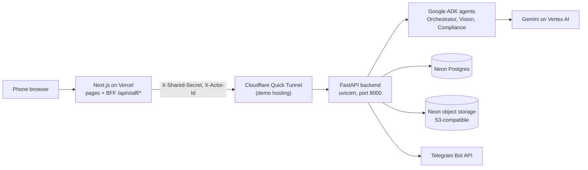
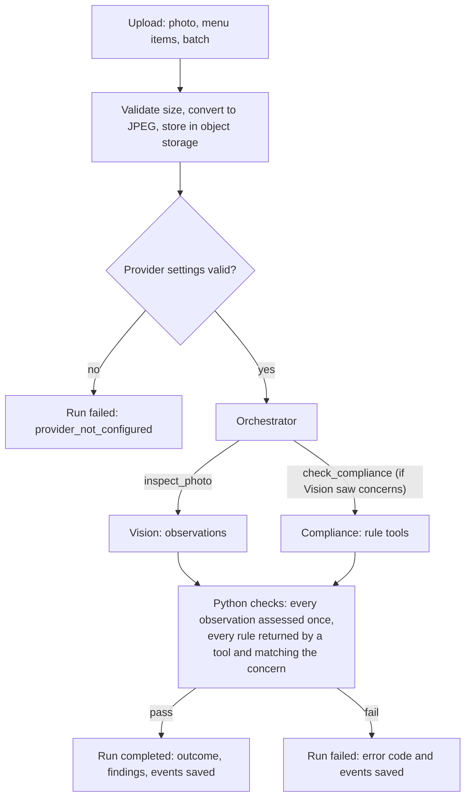
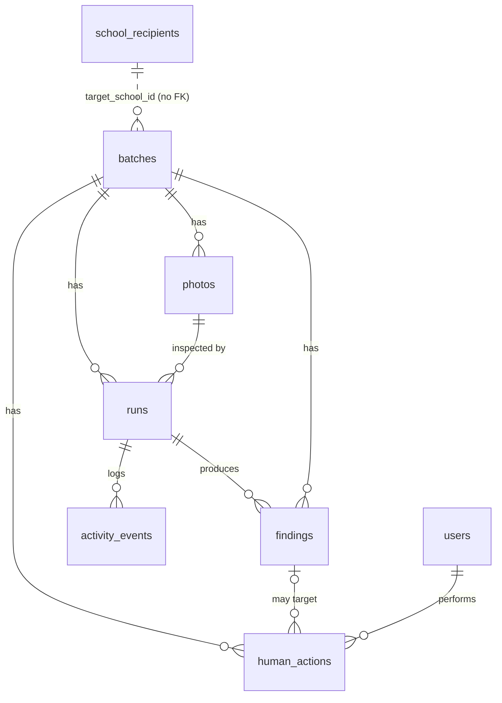

# Dapur Aman by Nexara

[Bahasa Indonesia](README.id.md)

A phone-first food-safety assistant for MBG (Makan Bergizi Gratis) school-meal kitchens. Kitchen staff photograph a meal tray before packing. Three Google ADK agents look for visible concerns and match them to a rule table. A person decides every outcome.

Built by team **Nexara Vision** for the **Agentic AI Hackathon 2026**, part of ITB Hackathon Series 2026 (21–23 October 2026).

> **Not a safety certificate.** A photo can only show visible concerns. The app never declares food safe, and every rule in it is a demo assumption with no linked regulation (see [Rules](#rules)). School, staff and menu data in the demo are synthetic.

Live demo: https://dapur-aman.vercel.app (see [Deployment](#deployment) for how the backend is hosted).

## Contents

- [Overview](#overview)
- [Features](#features)
- [Architecture](#architecture)
- [Technology stack](#technology-stack)
- [Workflows](#workflows)
- [AI agents](#ai-agents)
- [Frontend](#frontend)
- [Backend and API](#backend-and-api)
- [Database and storage](#database-and-storage)
- [Deployment](#deployment)
- [Configuration](#configuration)
- [Run locally](#run-locally)
- [Testing](#testing)
- [Security and human oversight](#security-and-human-oversight)
- [Known limitations](#known-limitations)
- [Troubleshooting](#troubleshooting)
- [Project structure](#project-structure)
- [Team](#team)

## Overview

MBG kitchens pack many trays in a short time, often before dawn. Checking every tray by eye is hard, and mistakes are easy to miss. Dapur Aman adds a second look at each photo and keeps a record of what was flagged, who handled it, and why.

| The AI does | The AI does not |
| --- | --- |
| Reads the photo and lists possible concerns, with a box on the photo where it can locate one | Decide that food is safe |
| Matches each concern to a rule in the rule table, or says no rule applies | Mark a finding fixed or dismissed |
| Notes what it could not see (uncertainty, evidence gaps, image quality) | Place or lift a hold on a batch |
| Proposes an outcome and one next step for staff | Close a batch or send the school report |

Every action that changes a finding or a batch goes through the human action endpoint, which the agents never call. A backend test checks this (`test_ai_never_closes_batch_or_resolves_findings`).

## Features

| Feature | What it does |
| --- | --- |
| Role-based login | Staff and supervisor accounts. After login, supervisors go to `/dashboard` and staff to `/staff`, based on the role the backend returns. |
| New batch from a photo | Staff enter a table or line name, menu components and a target school, then take or choose a photo. |
| Camera or gallery | "Ambil Foto" opens the rear camera; "Pilih dari Galeri" picks a saved photo when the camera is unavailable or blocked. |
| Photo preparation | The browser accepts JPEG, PNG or WebP up to 20 MB and resizes to a 1600 px long side as JPEG. The server rejects files over 4 MB and stores every photo as JPEG. |
| Menu tags | Menu components are typed as tags (Enter or comma adds one; case-insensitive duplicates are skipped). Vision checks the photo against them. A new batch starts with a demo menu and table "Meja 1"; a retake is prefilled with the batch's saved menu and table name. |
| AI progress stepper | Shows the three stages (Orkestrator from 0 s, Vision from 2 s, Kepatuhan from 9 s) while a run is in progress. The stages are timed indicators, not live server status. |
| Marked photo | Numbered boxes over each finding that has a location. Tapping a number jumps to that finding. Findings without a box appear only in the list. |
| Findings list | Level (safety or quality), explanation, rule reference, evidence gap and suggested action for each finding. |
| Finding decisions | "Sudah diperbaiki" (fixed) or "Abaikan dengan alasan" (dismiss with a reason). Fixed is offered only after a newer completed retake. |
| Retake | "Periksa foto ulang" adds a new photo to the same batch. Earlier findings keep their human decisions; the AI never clears them. |
| Holding timer | Time since the batch's first photo against a 4-hour demo limit. Turns amber in the last 30 minutes and red after the limit. |
| Supervisor dashboard | Headline counts, the latest open safety concern, a filterable batch list and per-school status. Refreshes every 20 seconds (can be turned off). Supervisor only. |
| Hold and lift hold | "Tahan batch" on the concern card and "Lepaskan tahanan" on the card or batch list, each with a reason. The buttons follow the saved batch status, and the result appears next to the form. Supervisor only. |
| Close batch | "Tutup batch" appears when the batch is not on hold, no findings are open, and the latest run completed without asking for a retake. |
| School report via Telegram | "Laporan Pemeriksaan Batch" for the school. Sent when a supervisor closes a batch, or on demand by a supervisor for a closed batch. It goes to the school's own chat if one is stored; the demo schools have none, so it goes to `TELEGRAM_SCHOOL_CHAT_ID` (or the supervisor chat). |
| Supervisor alerts via Telegram | An alert when a first photo has any finding (safety or quality), and a message when a retake shows findings or no visible concern. |
| Saved AI activity | "Aktivitas AI tersimpan" lists the agent and tool steps recorded for each run, with agent names and known steps in Bahasa Indonesia. |
| Human action history | "Riwayat tindakan manusia" lists who did what to a batch, when, and why. |

Not implemented: QR verification of trays or reports. There is no QR code in the frontend or backend.

## Architecture



- The browser talks only to the Next.js app on the same origin. A backend-for-frontend (BFF) route at `/api/staff/*` holds the session cookie and adds the server-only shared secret.
- The backend checks the shared secret on every data route and loads the acting user from `X-Actor-Id`, which the BFF takes from the signed session, never from the browser.
- Photos go to object storage; batches, runs, findings, events and human actions go to Postgres.

## Technology stack

| Layer | Technology |
| --- | --- |
| Frontend | Next.js 16.4 (App Router), React 19.3, TypeScript 5, MUI 9, Tailwind CSS 4, d3 7 |
| Package manager | Bun 1.4+ (`frontend/bun.lock`); Next.js runs on Node.js 24 |
| Backend | Python 3.13, FastAPI 0.141, SQLAlchemy 2.1, psycopg 3, Pydantic 2, uvicorn |
| AI | Google ADK 2.12, Gemini through Vertex AI; OpenRouter through LiteLLM as a manual alternative |
| Data | Neon Postgres; Neon object storage through boto3 (S3 API) |
| Images | Pillow (JPEG conversion and validation) |
| Auth | bcrypt password hashes; HMAC-signed session cookie |
| Notifications | Telegram Bot API |
| Hosting | Vercel (frontend); backend on a laptop behind a Cloudflare Quick Tunnel for the demo |
| Tooling | uv (Python), ESLint, pytest |

## Workflows

### Staff

1. Sign in with a staff account. The app opens the batch list at `/staff`.
2. Start a batch: choose a school, type a table or line name, check the menu tags, take or choose a photo.
3. Submit and wait for the stepper to finish. Do not submit again while it runs.
4. The review screen opens. Read the outcome and the holding timer. "No visible concern" still asks for a human check.
5. Check the marked photo and each finding. For a concern that needs a fix, correct the tray, then upload a new photo with "Periksa foto ulang".
6. After the retake has completed, mark the finding "Sudah diperbaiki" with a reason. Before that, the option reads "Sudah diperbaiki (perlu foto ulang)" and is disabled. A finding can instead be dismissed with a reason at any time.
7. When the batch is not on hold, no findings are open and the latest run completed without asking for a retake, check the trays by eye and press "Tutup batch".

### Supervisor

1. Sign in with a supervisor account. The app opens `/dashboard`. Other roles get a supervisor-only message; the backend returns 403.
2. Read the headline counts (safety findings, fixed by staff, dismissed, still open) and the latest open safety concern.
3. Hold a batch with "Tahan batch" on the concern card and a reason (at least 3 characters). The submit button stays disabled until the reason is long enough.
4. Filter batches by all, open, held or closed. Release a hold with "Lepaskan tahanan" and a reason. Held batches show the hold reason in the supervisor dashboard and in the staff batch list ("Ditahan supervisor — jangan distribusikan").
5. Open any batch with "Buka detail" to review it like staff do.
6. For a closed batch, send the school report with "Kirim laporan Telegram" (dashboard) or "Kirim laporan ke Telegram sekolah" (review screen).

### Decision rules

| Decision | Who | Rule enforced by the backend |
| --- | --- | --- |
| Mark a finding fixed | Staff or supervisor | Needs a reason and a newer completed run in the same batch; otherwise 409. |
| Dismiss a finding | Staff or supervisor | Needs a reason. No retake needed. |
| Place or lift a hold | Supervisor only | Needs a trimmed reason; staff get 403. Repeated holds and releasing a closed batch return 409. |
| Close a batch | Any signed-in user | Refused (400) while any finding is open or the batch is on hold. |
| Send the school report | Supervisor only | Batch must be closed (409 otherwise). Sent automatically only when a supervisor closes the batch. |

Reasons must be at least 3 characters after trimming. The BFF also caps them at 2000 characters; the backend has no upper limit. A hold blocks closing, but not new photos or finding decisions. The backend checks only the transitions above; see [Known limitations](#known-limitations) for the ones it does not block.

### Batch and run states

| Value | Meaning |
| --- | --- |
| Batch `in_review` | Open batch (default on creation) |
| Batch `on_hold` | A supervisor placed a hold |
| Batch `closed` | Closed by a person |
| Run outcome `clean` | No visible concern found. This does not prove the food is safe. |
| Run outcome `review_required` | Findings or uncertainty need a person to review |
| Run outcome `retake_required` | The photo is not enough to decide; take a new one |
| Run state `completed` | The agents finished and the Python checks passed |
| Run state `failed` | The inspection failed; no result is shown as a finding |

A run is saved only after it finishes, so `running` (defined in the contract) is never stored. The supervisor dashboard also derives display states that are not stored: `packing`, `finding_open` and `on_hold`.

## AI agents

### Agents and responsibilities

| Agent | Built by | Job | Tools | Input |
| --- | --- | --- | --- | --- |
| Orchestrator (`orchestrator`) | `backend/agents/orchestrator/agent.py` | Calls the specialists, picks the outcome, writes one next step for staff | `inspect_photo`, `check_compliance` | A text briefing: menu, reference photo present, earlier findings count, retake flag. It does not see the image. |
| Vision (`vision`) | `backend/agents/vision/adk_agent.py` | Lists visible concerns with normalized boxes, uncertainty and image-quality notes | None | The photo, menu items, known concern types, an optional reference photo, the earlier concern on a retake |
| Compliance (`compliance`) | `backend/agents/compliance/agent.py` | Matches each Vision observation to one rule, or says none applies | `lookup_rules`, `check_evidence`, `check_batch_history` | Vision observations and batch history from session state. It does not see the image. |

The Compliance tools are local and deterministic: they read the rule table and the run state. There is no web search or external retrieval. Each agent runs in its own in-memory ADK runner; one recorder collects events from all three in order (`backend/agents/workflow.py`).

### Model and provider

- `AI_PROVIDER` selects `vertex` (Gemini on Vertex AI), `openrouter` (through LiteLLM, with upstream fallbacks disabled) or `fixture` (a labelled simulated result for tests; no model call).
- `AI_MODEL` names the model. The provider code reads the environment directly, so `AI_PROVIDER`, `AI_MODEL` and, for Vertex, `GOOGLE_CLOUD_PROJECT` must be set in `backend/.env`. Defaults in `backend/app/config.py` are not applied to agent runs.
- Agents use temperature 0 and a 45-second bound per model call. Nothing switches provider automatically.

### Inspection lifecycle



1. The API rejects empty or oversized photos, converts to JPEG and uploads to object storage before any model call.
2. The Orchestrator calls Vision, then Compliance when Vision reported concerns.
3. Python code validates the agents' work: Compliance must assess every observation, and each cited rule must have been returned by a rule tool in this run and must cover the concern type. Compliance cannot cite a rule from memory.
4. Python builds one finding per observation: Vision's box and explanation, the level and reference of the matched rule, the evidence gaps from the tools and Compliance, and Compliance's suggested action. A concern with no matching rule defaults to level `safety`; if no other gap was recorded, its evidence gap says no rule covers it.
5. The Orchestrator may pick `no_visible_concern` only when there are no findings, image-quality issues or missing evidence. Otherwise the run fails.
6. The whole run has a 120-second limit. Findings, events and the run are saved; findings start as `open`.

### Failure behaviour

A run never invents a result. Any failed check ends the run as `failed`, its events and error are stored, and the API returns 424 with the error code, run ID and batch ID (not 502, which the Cloudflare tunnel replaces with its own error page). Only an agent reply that does not match the expected JSON format is retried, once, with a fixed repair message. Model errors, timeouts and tool failures are not retried, and the backend does not start a new run by itself.

| Error code | When |
| --- | --- |
| `provider_not_configured` | Missing or invalid AI settings |
| `vision_agent_missing` | The Vision agent module cannot be loaded |
| `unknown_rule_table` | Input names a rule table other than `rule-table-v1` |
| `run_timeout` | The run passes 120 seconds |
| `agent_error`, `model_error` | An agent or model call raised or returned an error |
| `invalid_agent_output`, `empty_reply` | An agent reply is malformed after one repair, or empty |
| `vision_not_run`, `compliance_not_run` | A required specialist did not complete |
| `assessment_mismatch` | Compliance assessments do not cover exactly the observed items |
| `unverified_rule`, `rule_mismatch` | A cited rule was not returned by a tool, or does not cover the concern |
| `unsupported_outcome`, `invalid_outcome` | The proposed outcome contradicts the findings or fails the contract |

### Output

The shared contract is `backend/agents/contract.py` (`InspectionOutcome`). A completed run has an `outcome`, `findings`, `uncertainty`, `next_action`, `events`, `provider` and `model`. Each finding has `level`, `concern_type`, `box` (normalized 0–1 or null), `explanation`, `rule_reference`, `evidence_gap` and `suggested_action`.

Activity events are recorded from ADK callbacks that actually fired: agent calls, tool calls, failed model calls, the one-time format repair, and the simulated step in fixture mode. Each has a sequence number, timestamp, agent, step, status and summary. `backend/agents/examples/inspection_outcome.json` is a synthetic example, not real output.

### Rules

The rule table is `rule-table-v1` in `backend/agents/compliance/rules.py`. A reference looks like `rule-table-v1:foreign-01`.

| Rule | Level | Concern types | Status |
| --- | --- | --- | --- |
| `foreign-01` | safety | foreign object, hair, insect, packaging fragment, caterpillar, worm, larva, pest, physical hazard | demo assumption |
| `cooking-01` | safety | undercooked, raw appearance | demo assumption |
| `spoilage-01` | safety | spoilage, mould, discoloration | demo assumption |
| `menu-01` | quality | missing or different component, empty compartment, menu mismatch | demo assumption |
| `portion-01` | quality | portion shortage (three variants) | demo assumption |
| `presentation-01` | quality | irregular or messy presentation, dirty tray, presentation issue | demo assumption |

**Verified rules versus demo assumptions.** No rule is source-backed yet: every rule has `source: None` and status `demo_assumption` until the team links a source. The 4-hour holding limit is also a demo assumption, labelled as such on screen. A rule only says which visible concern needs which human check; it never certifies food as safe.

## Frontend

### Pages

| Route | What it shows |
| --- | --- |
| `/` | Redirects to `/staff` |
| `/landing` | Static landing page with links to login and the dashboard |
| `/login` | Username and password form; routes by role after login |
| `/staff` | Staff batch list, newest first, searchable, and new-batch form |
| `/staff-review?batch=<id>`, `/staff-send-confirm` | The staff app in review mode for one batch |
| `/supervisor` | Redirects to `/dashboard` |
| `/dashboard` | Supervisor dashboard. Any signed-in user can open the page; other roles see a supervisor-only message because the data call returns 403. |

There is no route middleware: pages load data through the BFF, send the user to `/login` on 401, and rely on the backend for roles. `not-found.tsx` and `error.tsx` render the 404 and error pages. `frontend/app/sample/*.html` are static prototype snapshots kept for reference; they are not app routes.

### Components and modules

| File | Purpose |
| --- | --- |
| `app/components/StaffApp.tsx` | Staff flow: batch list, batch view, logout |
| `app/components/StaffShell.tsx` | Page frame, staff navigation, shared error message |
| `app/components/Login.tsx` | Login form and role-based redirect |
| `app/components/UploadForm.tsx` | New batch and retake upload; photo resizing |
| `app/components/BatchResult.tsx` | Run result, findings, decisions, close, report, activity and action history |
| `app/components/MarkedPhoto.tsx` | Photo with numbered finding boxes |
| `app/components/MenuTags.tsx` | Menu component tag input |
| `app/components/HoldingTimer.tsx` | Elapsed time against the 4-hour demo limit |
| `app/components/InspectionSteps.tsx` | Three-stage progress indicator during a run |
| `app/components/InspectionStatus.tsx` | Saved inspection status after the app is switched |
| `app/components/PitchPhoto.tsx` | Landing page photo with the marked spots |
| `app/components/icons.tsx` | Inline SVG icons |
| `lib/batch-list.ts` | Batch list order and search |
| `lib/contracts.ts` | API payload types and the browser `api()` helper for `/api/staff/*` |
| `lib/labels.ts` | Display labels for backend codes |
| `lib/pending-inspection.ts` | The inspection this device started |
| `lib/session.ts` | Session token signing and verification (server only) |
| `lib/staff-api.ts` | The BFF: validation, rate limits, backend calls (server only) |

### BFF operations (`/api/staff/<operation>`)

The route `frontend/app/api/staff/[...path]/route.ts` accepts GET and POST and forwards to `lib/staff-api.ts`. Responses are `Cache-Control: no-store`.

| Method | Operation | Backend call | Notes |
| --- | --- | --- | --- |
| POST | `login` | `POST /api/auth/login` | No session needed. 10 attempts per username per 10 minutes. Sets the session cookie. |
| POST | `logout` | none | Clears the cookie |
| GET | `session` | none | Returns the signed-in name and role |
| GET | `overview` | `GET /api/overview` | |
| GET | `schools` | `GET /api/schools` | |
| GET | `supervisor/dashboard`, `supervisor/feed` | `GET /api/supervisor/dashboard`, `/feed` | Backend returns 403 for non-supervisors |
| GET | `batches/{batch_id}` | `GET /api/batches/{batch_id}` | ID must match `[a-zA-Z0-9_-]{1,64}` |
| GET | `runs/{run_id}/events` | `GET /api/runs/{run_id}/events` | Same ID rule |
| POST | `actions` | `POST /api/actions` | Validates action, IDs and reason (3–2000 characters) |
| POST | `notifications/dispatch-report/{batch_id}` | `POST /api/notifications/dispatch-report/{batch_id}` | |
| POST | `inspect` | `POST /api/inspections/upload-and-run` | JPEG, PNG or WebP up to 4 MB. One run at a time and 10 per 10 minutes per account. The phone chooses the batch id and keeps it on the device, so a tab that was switched away finds the saved result again. |

Unknown operations return 404. The BFF does not expose `/api/notifications/test-alert` or `/api/vision/inspect`. Every operation except `login` needs a valid session cookie (401 otherwise). Every POST must come from the same origin (403 otherwise). Rate limits and the one-run guard are in memory per server instance.

## Backend and API

### Modules (`backend/app`)

| File | Job |
| --- | --- |
| `main.py` | FastAPI app, startup (tables, small migrations, seeding), CORS, all routes |
| `auth.py` | Shared-secret check (constant-time), current actor from `X-Actor-Id`, bcrypt helpers |
| `config.py` | Loads `backend/.env` and reads settings |
| `database.py` | SQLAlchemy engine, sessions, `get_db` |
| `inspection.py` | Bridge to the agents: JPEG conversion, response building, outcome labels |
| `models.py` | ORM models (see [Database and storage](#database-and-storage)) |
| `notifications.py` | Telegram alerts and the school report |
| `storage.py` | Photo upload and presigned URLs |
| `seed.py` | Default accounts and schools; `--reset-passwords` command |
| `schemas/` | Pydantic request and response models (auth, action, batch, supervisor, vision) |

`backend/agents/` holds the ADK agents, the workflow and the shared contract.

### Endpoints

All routes are in `backend/app/main.py`. "Secret" means the `X-Shared-Secret` header must match `BACKEND_SHARED_SECRET` (401 if wrong, 503 if the backend has none). "Actor" means `X-Actor-Id` must name a known user by ID or username (401 otherwise).

| Method | Path | Purpose | Secret | Actor | Role |
| --- | --- | --- | --- | --- | --- |
| GET | `/health` | Health check | No | No | Public |
| POST | `/api/auth/login` | Check username and password; return actor ID, name and role | Yes | No | Any |
| POST | `/api/inspections/upload-and-run` | Store the photo, run the three agents, save the run and findings | Yes | Yes | Any |
| POST | `/api/vision/inspect` | Alias of the route above | Yes | Yes | Any |
| GET | `/api/overview` | Staff home data: headline and batch rows (status, hold reason). Menus are stored per batch, so its menu list is empty. | Yes | Yes | Any |
| GET | `/api/batches/overview` | Alias of `/api/overview` | Yes | Yes | Any |
| GET | `/api/supervisor/dashboard` | Supervisor dashboard data | Yes | Yes | Supervisor |
| GET | `/api/supervisor/feed` | Alias of the dashboard route | Yes | Yes | Supervisor |
| GET | `/api/batches/{batch_id}` | Batch detail: runs, findings, actions, fresh photo URLs | Yes | Yes | Any |
| GET | `/api/runs/{run_id}/events` | Saved activity events for one run | Yes | Yes | Any |
| GET | `/api/schools` | School recipients | Yes | Yes | Any |
| POST | `/api/actions` | Record `fixed`, `dismissed`, `on_hold`, `lift_hold` or `close` | Yes | Yes | Any; `on_hold` and `lift_hold` supervisor only |
| POST | `/api/notifications/test-alert` | Send a sample alert to the supervisor Telegram chat (optional `table_name`, `batch_id` query) | Yes | Yes | Supervisor |
| POST | `/api/notifications/dispatch-report/{batch_id}` | Send the school report for a closed batch (optional `school_id` query) | Yes | Yes | Supervisor |

That is 14 paths served by 11 handlers. FastAPI also serves `/docs`, `/redoc` and `/openapi.json` (schema only, no data).

## Database and storage

Neon Postgres holds eight tables, defined as SQLAlchemy models in `backend/app/models.py`. Photo bytes live in object storage; the database keeps only their keys.

**How much is verified.** The tables below are read from the model code and the startup code in `backend/app/main.py`. They were not compared against the live Neon database, which could differ if it was ever changed by hand.

### Overview

| Table | Holds | Supports |
| --- | --- | --- |
| `users` | Staff and supervisor accounts | Login, roles, the actor of each human action, supervisor Telegram chat |
| `batches` | One packing table or line for one school | Status, hold, close, the menu Vision checks against |
| `photos` | One uploaded photo per inspection | First photo and retakes |
| `runs` | One AI inspection of one photo | Outcome, failure details, provider and model |
| `findings` | One concern from a run | Marked photo, human decisions |
| `activity_events` | Ordered agent and tool steps of a run | "Aktivitas AI tersimpan" |
| `human_actions` | Every staff or supervisor decision with its reason | "Riwayat tindakan manusia", hold history |
| `school_recipients` | Schools that receive portions | School report, per-school dashboard status |



### Columns

Types are as SQLAlchemy creates them on PostgreSQL. `TIMESTAMP` has no time zone. A default marked "app" is set by Python on insert; "db" means a database default (`now()`). IDs are strings: generated by the app for batches, photos, runs, findings and actions (such as `batch_…` or `fnd_…`), and fixed in `seed.py` for the demo accounts and schools. Expand a table to see its columns.

<details>
<summary><code>users</code></summary>

| Column | Type | Null | Default | Notes |
| --- | --- | --- | --- | --- |
| `id` | VARCHAR(50) | No | | Primary key |
| `username` | VARCHAR(100) | No | | Unique index `ix_users_username` |
| `password_hash` | VARCHAR(255) | No | | bcrypt |
| `name` | VARCHAR(150) | No | | |
| `role` | VARCHAR(50) | No | | `kitchen_staff` or `supervisor` |
| `phone_number` | VARCHAR(50) | Yes | | |
| `telegram_chat_id` | VARCHAR(100) | Yes | | Supervisor alerts |
| `created_at` | TIMESTAMP | Yes | app, db `now()` | |

</details>

<details>
<summary><code>batches</code></summary>

| Column | Type | Null | Default | Notes |
| --- | --- | --- | --- | --- |
| `id` | VARCHAR(50) | No | | Primary key |
| `menu_id` | VARCHAR(50) | No | app `MBG-01` | |
| `menu_name` | VARCHAR(200) | No | app `Menu Hari Ini` | The menu components Vision checks |
| `table_name` | VARCHAR(100) | Yes | | Shown as "School • Table (N Porsi)" |
| `target_school_id` | VARCHAR(50) | Yes | | Points at `school_recipients.id`; no foreign key |
| `target_school_name` | VARCHAR(150) | Yes | | |
| `status` | VARCHAR(50) | No | app `in_review` | `in_review`, `on_hold`, `closed` |
| `hold_reason` | TEXT | Yes | | Set by `on_hold`, cleared by `lift_hold` |
| `hold_by` | VARCHAR(50) | Yes | | User ID; no foreign key |
| `created_at` | TIMESTAMP | Yes | app, db `now()` | Start of the 4-hour demo timer |
| `updated_at` | TIMESTAMP | Yes | app; updated by the app on change | |

</details>

<details>
<summary><code>photos</code></summary>

| Column | Type | Null | Default | Notes |
| --- | --- | --- | --- | --- |
| `id` | VARCHAR(50) | No | | Primary key |
| `batch_id` | VARCHAR(50) | No | | FK `batches.id`, on delete cascade |
| `object_key` | VARCHAR(500) | No | | `photos/<batch_id>/<photo_id>.jpg` |
| `media_type` | VARCHAR(50) | No | app `image/jpeg` | |
| `file_size_bytes` | INTEGER | Yes | | |
| `created_at` | TIMESTAMP | Yes | app, db `now()` | |

</details>

<details>
<summary><code>runs</code></summary>

| Column | Type | Null | Default | Notes |
| --- | --- | --- | --- | --- |
| `id` | VARCHAR(50) | No | | Primary key |
| `batch_id` | VARCHAR(50) | No | | FK `batches.id`, on delete cascade |
| `photo_id` | VARCHAR(50) | No | | FK `photos.id`, on delete cascade |
| `state` | VARCHAR(50) | No | app `completed` | `completed` or `failed` |
| `outcome` | VARCHAR(50) | Yes | | `clean`, `review_required`, `retake_required` |
| `headline` | VARCHAR(255) | Yes | | |
| `summary_label` | VARCHAR(128) | Yes | | |
| `primary_action_label` | VARCHAR(128) | Yes | | |
| `next_action` | TEXT | Yes | | The Orchestrator's next step for staff |
| `uncertainty_json` | JSON | Yes | | |
| `error_json` | JSON | Yes | | Error code and details of a failed run |
| `raw_observation` | JSON | Yes | | The validated agent output |
| `provider` | VARCHAR(50) | No | app `vertex` | |
| `model` | VARCHAR(100) | No | app `gemini-3.8-flash` | The model actually used is saved per run |
| `created_at` | TIMESTAMP | Yes | app, db `now()` | |

</details>

<details>
<summary><code>findings</code></summary>

| Column | Type | Null | Default | Notes |
| --- | --- | --- | --- | --- |
| `id` | VARCHAR(50) | No | | Primary key |
| `run_id` | VARCHAR(50) | No | | FK `runs.id`, on delete cascade |
| `batch_id` | VARCHAR(50) | No | | FK `batches.id`, on delete cascade |
| `level` | VARCHAR(50) | No | | `safety` or `quality` |
| `concern_type` | VARCHAR(100) | No | | |
| `box_json` | JSON | Yes | | Normalized box, or null |
| `explanation` | TEXT | No | | |
| `rule_reference` | VARCHAR(150) | Yes | | For example `rule-table-v1:foreign-01` |
| `evidence_gap` | TEXT | Yes | | |
| `suggested_action` | TEXT | No | app (generic Bahasa text) | |
| `status` | VARCHAR(50) | No | app `open` | `open`, `fixed`, `dismissed` |
| `resolution_note` | TEXT | Yes | | The human's reason |
| `resolution_actor_id` | VARCHAR(50) | Yes | | User ID; no foreign key |
| `resolution_at` | TIMESTAMP | Yes | | |

</details>

<details>
<summary><code>activity_events</code></summary>

| Column | Type | Null | Default | Notes |
| --- | --- | --- | --- | --- |
| `id` | VARCHAR(50) | No | | Primary key |
| `run_id` | VARCHAR(50) | No | | FK `runs.id`, on delete cascade |
| `sequence` | INTEGER | No | app `1` | Order within the run |
| `agent` | VARCHAR(50) | No | app `VisionAgent` | |
| `step` | VARCHAR(100) | No | app `vision_inspection` | |
| `parent_step` | VARCHAR(100) | Yes | | |
| `kind` | VARCHAR(50) | No | app `agent_execution` | Agent, tool or model call, validation, simulated |
| `status` | VARCHAR(50) | No | app `completed` | `started`, `completed`, `failed`, `retrying` |
| `summary` | TEXT | No | | |
| `references_json` | JSON | Yes | | |
| `uncertainty` | TEXT | Yes | | |
| `error` | TEXT | Yes | | |
| `timestamp` | TIMESTAMP | Yes | app, db `now()` | |

</details>

<details>
<summary><code>human_actions</code></summary>

| Column | Type | Null | Default | Notes |
| --- | --- | --- | --- | --- |
| `id` | VARCHAR(50) | No | | Primary key |
| `batch_id` | VARCHAR(50) | No | | FK `batches.id`, on delete cascade |
| `finding_id` | VARCHAR(50) | Yes | | FK `findings.id`, on delete set null |
| `action` | VARCHAR(50) | No | | `fixed`, `dismissed`, `on_hold`, `lift_hold`, `close` |
| `actor_id` | VARCHAR(50) | No | | FK `users.id` (no delete rule) |
| `reason` | TEXT | No | | Trimmed, at least 3 characters |
| `created_at` | TIMESTAMP | Yes | app, db `now()` | |

</details>

<details>
<summary><code>school_recipients</code></summary>

| Column | Type | Null | Default | Notes |
| --- | --- | --- | --- | --- |
| `id` | VARCHAR(50) | No | | Primary key (`sch_01` to `sch_03` in the demo) |
| `name` | VARCHAR(150) | No | | |
| `principal_name` | VARCHAR(150) | No | | |
| `phone_number` | VARCHAR(50) | No | | |
| `telegram_chat_id` | VARCHAR(100) | Yes | | Not seeded; the report falls back to the configured chat |
| `portion_count` | INTEGER | No | app `400` | |
| `address` | VARCHAR(255) | Yes | | |
| `created_at` | TIMESTAMP | Yes | app, db `now()` | |

</details>

### Keys, constraints and delete behaviour

- **Indexes.** Only the primary keys and the unique `users.username` index. Foreign-key columns have no index of their own.
- **No database checks.** There are no `CHECK` constraints or enum types, so status values are enforced by the backend code and Pydantic schemas only.
- **Cascades.** Deleting a batch deletes its photos, runs, findings and human actions, both in the database (`ON DELETE CASCADE`) and through the ORM. Deleting a run deletes its findings and activity events. Deleting a finding keeps its human actions and sets their `finding_id` to null. The app itself never deletes rows.
- **Plain ID links.** `batches.target_school_id`, `batches.hold_by` and `findings.resolution_actor_id` hold IDs without a foreign key.

### Startup schema changes and seeding

**Startup changes the schema.** Every backend start runs, in order: `create_all` (creates missing tables, never alters existing ones); four `ALTER TABLE ... ADD COLUMN IF NOT EXISTS` statements for `users.phone_number`, `users.telegram_chat_id`, `batches.target_school_id` and `batches.target_school_name` (a failure is logged as a warning, not raised); then seeding. There is no migration tool and no migration history. Point a development backend at a separate database or a Neon branch, never at production by accident.

**Seeding.** `backend/app/seed.py` fills only `users` and `school_recipients`. It adds the demo accounts `staff1` (`kitchen_staff`) and `supervisor1` (`supervisor`) when missing, and three synthetic schools when missing. Passwords come from `SEED_STAFF_PASSWORD` and `SEED_SUPERVISOR_PASSWORD`; without both, account seeding is skipped. Existing accounts keep their passwords, but their phone number and Telegram chat are refreshed on every start when a seed value is set (the supervisor chat comes from `TELEGRAM_SUPERVISOR_CHAT_ID`, falling back to `TELEGRAM_CHAT_ID`). Existing schools are never changed. `uv run python -m app.seed --reset-passwords` (from `backend/`) replaces both password hashes.

### Object storage

Photos are stored in a private Neon object storage bucket through the S3 API (`backend/app/storage.py`), as `photos/<batch_id>/<photo_id>.jpg`. The app never makes objects public. It creates presigned read URLs on each request: 10 minutes for the app screens and the supervisor Telegram alerts, 1 hour for the Telegram school report. A photo link in an older alert stops working after 10 minutes. The code uses the generic S3 API through the `STORAGE_*` settings, so any S3-compatible bucket works.

## Deployment

### Current state

| Part | State |
| --- | --- |
| Frontend | Vercel production at https://dapur-aman.vercel.app, deployed automatically from `main` |
| Backend (demo) | Runs on a team member's Windows laptop (`127.0.0.1:8000`), exposed through a Cloudflare Quick Tunnel. Vercel's `BACKEND_URL` points at the tunnel. |
| Backend (Cloud Run) | A private service was deployed to Google Cloud Run (`asia-southeast2`) but is not used, because of the IAM limits below |
| Database and storage | Neon Postgres and Neon object storage |
| AI | Gemini on Vertex AI, called from the backend |

The demo works only while the laptop is on and connected.

### Cloud Run and IAM limits

The frontend already supports a private Cloud Run backend: when `GCP_INVOKER_CREDENTIALS` holds a service-account key, the BFF mints a Google ID token whose audience is the `BACKEND_URL` origin and sends it as `Authorization`, in addition to the shared secret. Two project permissions blocked this setup, and team members cannot change project IAM:

1. The Cloud Run runtime service account lacks the Vertex AI user role (`roles/aiplatform.user`), so agent calls would fail.
2. The team cannot create service-account keys (`iam.serviceAccountKeys.create`), so Vercel has no credential to mint ID tokens.

Both need the organiser. Until then, the laptop and tunnel setup is the production backend.

### Laptop and Cloudflare Quick Tunnel

A Quick Tunnel gets a new random `https://<words>.trycloudflare.com` URL every time it restarts, and Vercel must then be updated and redeployed. The operator uses a one-click Windows launcher and a matching stop script that are kept on the demo laptop and not committed to this repository. The launcher automates the steps below: it checks for `uv`, `cloudflared`, `backend/.env` and an internet connection; reuses healthy processes and starts only what is missing; updates `BACKEND_URL` and redeploys Vercel when the tunnel URL changed or Vercel cannot reach the backend; then checks the chain, including a real staff login when a seed password is configured. It needs the Vercel CLI, logged in and linked to the project. The stop script ends the backend on port 8000 and every `cloudflared` process on the machine.

Manual equivalent:

```sh
# 1. Backend (from backend/, with backend/.env in place)
uv run uvicorn app.main:app --host 127.0.0.1 --port 8000
curl http://127.0.0.1:8000/health          # {"status":"ok","service":"dapur-aman-backend"}

# 2. Tunnel (second terminal); note the printed trycloudflare.com URL
cloudflared tunnel --no-autoupdate --url http://127.0.0.1:8000

# 3. Only if the URL changed (from frontend/, linked to the Vercel project)
vercel env update BACKEND_URL production --value https://<words>.trycloudflare.com --yes
vercel redeploy https://dapur-aman.vercel.app --target production
```

The redeploy takes about a minute; during that time the app cannot reach the backend. To check the chain without writing anything, post a login with a made-up username to `https://dapur-aman.vercel.app/api/staff/login` (with a matching `Origin` header): HTTP 401 means Vercel reached the backend; 502 or 503 means it did not. A 401 does not prove the shared secrets match, because the backend also answers 401 to a wrong secret on login. Signing in with a real account checks the full chain.

To stop the manual setup, press Ctrl+C in each terminal. Restarting only the backend keeps the tunnel URL; restarting the tunnel requires the `BACKEND_URL` update above.

## Configuration

Names only. Real values live in `backend/.env`, `frontend/.env.local` and the Vercel project settings, never in Git. Copy `backend/.env.example` and `frontend/.env.example` to start.

### Backend

| Name | Purpose | Required |
| --- | --- | --- |
| `AI_PROVIDER` | `vertex`, `openrouter` or `fixture` | Yes |
| `AI_MODEL` | Model ID for the provider | Yes, except `fixture` |
| `GOOGLE_CLOUD_PROJECT` | Google Cloud project for Vertex AI | Yes for `vertex` |
| `GOOGLE_CLOUD_LOCATION` | Vertex AI location | Recommended for `vertex` |
| `GOOGLE_GENAI_USE_VERTEXAI` | Tells the Google GenAI library to use Vertex AI | Recommended for `vertex` |
| `OPENROUTER_API_KEY` | OpenRouter key | Only for `openrouter` |
| `DATABASE_URL` | Postgres connection string (`postgresql://` is rewritten for psycopg 3) | Yes |
| `DATABASE_URL_UNPOOLED` | Direct connection string; read but currently unused | No |
| `STORAGE_ENDPOINT`, `STORAGE_REGION`, `STORAGE_BUCKET` | Object storage location | Yes for photo upload |
| `STORAGE_ACCESS_KEY_ID`, `STORAGE_SECRET_ACCESS_KEY` | Object storage credentials | Yes for photo upload |
| `BACKEND_SHARED_SECRET` | Must equal the frontend value; empty makes guarded routes return 503 | Yes |
| `CORS_ALLOWED_ORIGINS` | Comma-separated browser origins; not needed for the BFF flow | No |
| `SEED_STAFF_PASSWORD`, `SEED_SUPERVISOR_PASSWORD` | Passwords for the seeded demo accounts | To seed accounts |
| `TELEGRAM_BOT_TOKEN` | Bot token; without it, messages are only logged | No |
| `TELEGRAM_CHAT_ID` | Fallback chat for supervisor alerts and school reports | No |
| `TELEGRAM_SUPERVISOR_CHAT_ID`, `TELEGRAM_SCHOOL_CHAT_ID` | Specific chats; fall back to `TELEGRAM_CHAT_ID` | No |

### Frontend

| Name | Purpose | Required |
| --- | --- | --- |
| `BACKEND_URL` | Backend base URL; must be HTTPS except for localhost | Yes |
| `BACKEND_SHARED_SECRET` | Sent as `X-Shared-Secret`; never reaches the browser | Yes |
| `SESSION_SECRET` | HMAC key for the session cookie; at least 32 characters | Yes |
| `GCP_INVOKER_CREDENTIALS` | Service-account key JSON for Cloud Run ID tokens | Only for a private Cloud Run backend |

## Run locally

Needs [Bun](https://bun.sh) 1.4 or later, Node.js 24 and [uv](https://docs.astral.sh/uv/) (uv installs Python 3.13 itself). Bun installs the frontend packages from `frontend/bun.lock`; do not use npm or pnpm. Next.js runs on Node, so `node` must be on your PATH. On NixOS, run the frontend commands inside `nix shell nixpkgs#nodejs_24`.

1. Copy `backend/.env.example` to `backend/.env` and `frontend/.env.example` to `frontend/.env.local`, then fill in values. Never commit them. For a local frontend, set `BACKEND_URL=http://localhost:8000`.
2. Start the backend (http://localhost:8000):

   ```sh
   cd backend
   uv sync
   uv run uvicorn app.main:app --reload --port 8000
   ```

   http://localhost:8000/health should return `{"status":"ok",...}`. Interactive API docs are at http://localhost:8000/docs.
3. Start the frontend (http://localhost:3000):

   ```sh
   cd frontend
   bun install --frozen-lockfile
   bun run dev
   ```

4. Stop each with Ctrl+C.

Remember that the backend changes the schema of the database in `DATABASE_URL` on start (see [Database and storage](#database-and-storage)).

**Shared models:** `backend/agents/contract.py`; a static example is in `backend/agents/examples/inspection_outcome.json`. To generate frontend types with the backend running: `bunx openapi-typescript http://localhost:8000/openapi.json -o lib/api-types.ts` (inside `frontend/`). Never edit the generated file by hand.

## Testing

None of the automated tests call a paid model, Neon, object storage or Telegram.

**Backend** (from `backend/`; uses in-memory SQLite and scripted model replies):

```sh
uv run --with pytest --with httpx pytest -q
```

Result on 22 October 2026: 92 passed (10 test files). `backend/conftest.py` forces in-memory SQLite before the app loads and stops the run if the configured database is still in use, so tests never reach Neon. It also blanks the Telegram settings and blocks Telegram sends in every test.

| File | Covers |
| --- | --- |
| `tests/agents/test_workflow.py` | Agent wiring, validation, failure paths, timeout, the single format repair |
| `tests/agents/test_compliance_tools.py` | Rule lookup, evidence and batch-history tools |
| `tests/agents/test_vision_agent.py` | Vision agent build and inputs |
| `tests/app/test_human_control.py` | AI never resolves findings or closes batches; fixed needs a retake; hold and release with reasons, refresh, permissions, invalid transitions and close restrictions |
| `tests/app/test_inspection_api.py` | Secret and actor guards on upload, JPEG conversion, failed runs never shown as clean |
| `tests/app/test_retake_supervisor.py` | Retakes, supervisor routes, overview and detail data |
| `tests/app/test_staff_integration.py` | Data routes need a verified actor; run events |
| `tests/app/test_notifications.py` | School report wording and deadline (nothing sent) |
| `tests/app/test_telegram_isolation.py` | Telegram settings blank and HTTP blocked during tests |
| `tests/app/test_database_isolation.py` | Tests run on in-memory SQLite, never the configured database |

Do not run `backend/test_vision.py` or `backend/test_backend_full.py` casually: they are manual scripts that call live services, and `test_vision.py` makes a paid model call.

**Frontend** (from `frontend/`):

| Command | Checks |
| --- | --- |
| `node --test --test-isolation=none tests/session.test.mjs tests/staff-api.test.cjs tests/labels.test.mjs tests/dashboard-hold.test.cjs tests/pending-inspection.test.mjs tests/batch-picker.test.mjs` | Session signing; the BFF handlers against the isolated test backend, which must be running on port 8765 first (see `frontend/tests/README.md`); Bahasa labels and WIB times; dashboard hold and release state and feedback; the pending inspection kept on the phone; the batch list order and search. 28 passed on 22 October 2026. |
| `bun run lint` | ESLint |
| `bunx next typegen` then `bunx tsc --noEmit` | TypeScript |
| `bun run build` | Production build |

For a full local browser journey without cloud services, `backend/tests/local_mvp_server.py` starts an in-memory backend with a scripted model (`uv run --with pytest python tests/local_mvp_server.py` from `backend/`). It is for testing only; never point a production frontend at it.

**Verified beyond the automated tests (22 October 2026):** the supervisor hold, refresh, release and refresh flow, inline feedback, and the staff view of a held batch were checked in a browser at 360 and 390 px against the isolated test backend, with no horizontal overflow. Against production, only read-only checks ran: health, both logins, 401 without the shared secret, staff 403 on the supervisor dashboard, and saved hold reasons in batch data. The hold, release and close refusals were not exercised on production data; the backend tests cover them.

## Security and human oversight

- **Secrets stay on servers.** The browser holds only an httpOnly, SameSite=Strict session cookie (8 hours, HMAC-signed, `Secure` in production). The shared secret and backend URL exist only on the Vercel server and the backend.
- **Every data route is guarded.** The backend checks the shared secret in constant time and requires a known actor; supervisor routes check the role.
- **The BFF validates input** (IDs, actions, reasons, photo type and size), rejects cross-origin POSTs and rate-limits login and inspections.
- **Passwords** are stored as bcrypt hashes. Demo account passwords come from environment variables and are not in the repository.
- **Rotate exposed credentials.** If the Telegram bot token appears in a log, test output or chat, revoke it through @BotFather and update `TELEGRAM_BOT_TOKEN` (the token is part of the Telegram API URL, so error logs can contain it). If a demo password is shared beyond the team, change `SEED_STAFF_PASSWORD` and `SEED_SUPERVISOR_PASSWORD`, then run `--reset-passwords`. Never paste either into issues, screenshots or prompts.
- **What stays public.** The tunnel itself has no authentication: `/health` and the FastAPI docs (`/docs`, `/redoc`, `/openapi.json`, schema only) are reachable without the secret; every `/api/*` route needs it.
- **Photos are private** and shown through short-lived presigned URLs.
- **Humans decide.** The agents can only create runs, findings (as `open`) and events. Fixing, dismissing, holding, closing and reporting are human actions with a recorded reason and actor, enforced by the backend and covered by tests.
- **Failures are visible.** A failed or timed-out run is shown as failed, never as a clean result.

## Known limitations

- **Photo-only evidence.** The agents cannot check temperature, smell, texture or storage time, and a photo cannot show microbiological safety. Outputs can be wrong; temperature 0 reduces variation but does not make the output correct.
- **Rules are demo assumptions.** No rule is linked to a regulation yet, and the 4-hour holding limit is unverified.
- **Holding time starts at the first photo.** The timer, the dashboard footer and the school report's deadline all count the 4-hour demo limit from the batch's first photo, not from the end of cooking, so the real time since cooking can be longer.
- **Any signed-in user can close a batch.** The school report is sent automatically only when a supervisor closes.
- **A hold blocks closing only.** It does not block new photos or finding decisions.
- **Some status changes are not blocked by the backend.** The UI does not offer them, but the API accepts:
  - a hold on a closed batch, or `lift_hold` on a batch that is not held;
  - closing an already closed batch (a supervisor re-close sends the school report again);
  - `fixed` or `dismissed` on an already resolved finding, and a retake on a closed batch.

  The "latest run did not ask for a retake" condition for closing is checked in the UI only. Status checks have no row locks, so two simultaneous actions can race.
- **Telegram delivery is not confirmed.** Alerts are sent in the background and not retried; failures are only logged. The report endpoint returns success even when Telegram was not configured or refused the message, and the UI then still says it was sent.
- **Model timeouts.** Each model call has 45 seconds and a run 120 seconds. A slow Vertex AI call (for example `DEADLINE_EXCEEDED` on the Compliance step, seen on 22 October 2026) ends the run as failed with a retryable error. Nothing retries automatically: staff retry with a new photo in the same batch.
- **Only Vision sees the photo.** The Orchestrator and Compliance agents work from Vision's text.
- **Demo hosting.** The backend depends on one laptop and a Quick Tunnel; each tunnel restart needs a Vercel update and about a minute of redeploy downtime. Cloud Run is blocked on IAM.
- **In-memory limits.** BFF rate limits and the one-run guard reset on restart and are not shared between Vercel instances. Sessions cannot be revoked before they expire.
- **The pending inspection lives on the phone.** The batch id is kept in the browser's local storage, so a second phone cannot see an inspection that is still running and clearing the browser data loses the pointer. The batch and its result stay on the server.
- **No migrations.** Schema changes run at backend startup.
- **QR verification is not implemented.**
- `backend/agents/vision/agent.py` and `prompts.py` are an older Vision path: still imported with the package, but never run by the inspection workflow.

## Troubleshooting

| Symptom (message shown) | Likely cause | Fix |
| --- | --- | --- |
| "Koneksi backend belum dikonfigurasi." | `BACKEND_URL` or `BACKEND_SHARED_SECRET` missing in the frontend | Set both (Vercel or `frontend/.env.local`); redeploy |
| "Backend memerlukan koneksi HTTPS." | `BACKEND_URL` is `http://` on a non-local host | Use the `https://` tunnel or service URL |
| "Sesi belum dikonfigurasi. Isi SESSION_SECRET di server (minimal 32 karakter)." | `SESSION_SECRET` missing or too short | Set a random value of at least 32 characters; redeploy |
| "Nama pengguna atau kata sandi salah." with a correct password | Frontend and backend shared secrets differ (login 401), or the demo accounts were never seeded | Make `BACKEND_SHARED_SECRET` identical on both sides; set `SEED_*` and restart the backend |
| "Backend menolak kunci server. Periksa BACKEND_SHARED_SECRET." | Shared secret mismatch on a data route | Same as above |
| "Login backend belum tersedia." or "Permintaan gagal. Coba lagi atau periksa koneksi server." on login | Backend down, tunnel dead, or `BACKEND_URL` still points at an old tunnel | Check `/health` locally and through the tunnel; update `BACKEND_URL` and redeploy |
| "Koneksi backend terputus atau melewati batas waktu. ..." | Backend unreachable or the call passed 150 seconds | Check the tunnel; reload the batch to see what was saved before retrying |
| "Backend belum dapat menyelesaikan permintaan. ..." | Backend 5xx: database error, missing secret on the backend, or a failed photo upload to object storage | Check the backend log, `backend/.env` and the `STORAGE_*` values |
| "Sesi berakhir. Silakan masuk kembali." (dashboard: "Sesi berakhir. Masuk kembali untuk membuka dasbor.") | Cookie older than 8 hours, or `SESSION_SECRET` changed | Sign in again |
| "Akun Anda tidak berwenang untuk tindakan ini. Hanya supervisor yang dapat melakukannya." | Staff account on a supervisor action | Expected; use a supervisor account |
| "Dasbor ini hanya untuk supervisor. Masuk dengan akun supervisor untuk melihatnya." | Staff account on `/dashboard` | Expected; use a supervisor account |
| Inspection fails with `provider_not_configured` | `AI_PROVIDER`, `AI_MODEL` or `GOOGLE_CLOUD_PROJECT` missing | Set them in `backend/.env`; restart the backend |
| New tunnel URL does not resolve on the laptop | Local DNS is slow to pick up new `trycloudflare.com` names | Test through a public resolver, for example `nslookup <host> 1.1.1.1`, or `curl --resolve` |
| "Cloud Run menolak permintaan server. ..." or "Token Cloud Run tidak dapat dibuat. ..." | `GCP_INVOKER_CREDENTIALS` set but invalid or without invoker access | Remove it unless the backend is on Cloud Run |

## Project structure

```text
dapur-aman/
├── backend/
│   ├── agents/
│   │   ├── orchestrator/agent.py   Orchestrator agent
│   │   ├── vision/adk_agent.py     Vision agent (agent.py, prompts.py: older path, unused)
│   │   ├── compliance/             Compliance agent, tools, rule table
│   │   ├── workflow.py             run_inspection: runs and validates the agents
│   │   ├── contract.py             Shared inspection contract
│   │   ├── providers.py            Vertex AI, OpenRouter, fixture
│   │   ├── activity.py             Activity events from ADK callbacks
│   │   └── examples/               Synthetic example outcome
│   ├── app/                        FastAPI app (see Modules)
│   ├── tests/                      pytest suites and the local MVP server
│   ├── example_image/              Sample tray photos
│   ├── test_vision.py, test_backend_full.py   Manual live-service scripts (not pytest)
│   ├── pyproject.toml, uv.lock, .python-version
│   └── .env.example
├── frontend/
│   ├── app/                        Pages, components, BFF route, prototype samples
│   ├── lib/                        Contracts, labels, session, BFF logic
│   ├── tests/                      Node test runner suites
│   ├── package.json, bun.lock, next.config.ts, eslint.config.mjs, shell.nix
│   └── .env.example
├── DEVELOPMENT.md                  Team development guide (planning notes; the code is authoritative)
├── README.md, README.id.md
└── LICENSE
```

## Team

| Name   | Role                | What the role covers                                   |
| ------ | ------------------- | ------------------------------------------------------ |
| Rabab  | Hustler (team lead) | Business side: product strategy, pitch, team coordination |
| Zayed  | Hacker              | Builds the product: code, AI and back end              |
| Finiko | Hipster             | Designs the user experience: interface and front end   |
| Rohmat | Hacker              | Builds the product: code, AI and back end              |

## Use of AI tools

> **Pending team confirmation.** The event rules allow AI coding assistants and generative models. The team has not yet finalised its disclosure of which tools were used and for which parts. This section will list them once the team confirms; until then it is not a complete disclosure.

The product itself uses Google ADK agents with Gemini on Vertex AI, as described in [AI agents](#ai-agents).

## License

[MIT](LICENSE)
