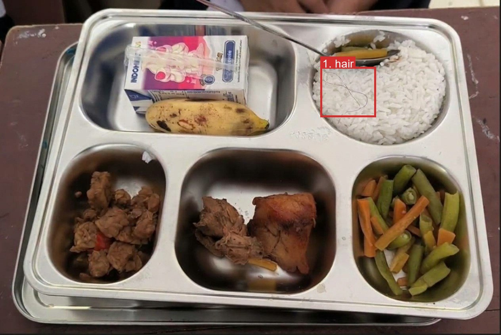
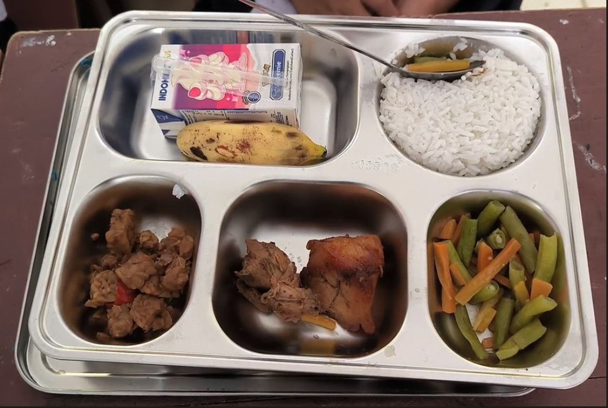

# Testing evidence

Every row below comes from a run the team actually did, with its date and source. No metric here is estimated. Demo data and test photos are synthetic.

## 1. Automated tests (22 Oct 2026, frozen commit)

| Suite | Command | Result |
| --- | --- | --- |
| Backend (pytest, in-memory SQLite, scripted model replies, no paid calls) | `cd backend && uv run --with pytest --with httpx pytest -q` | **92 passed** |
| Frontend unit tests (`.mjs`) | `cd frontend && node --test --test-isolation=none tests/*.mjs` | **13 passed, 0 failed** |
| Frontend integration tests (`.cjs`) | Need the scripted backend `backend/tests/local_mvp_server.py` on port 8765 | 16/16 passed with it running (22 Oct); fail with 502 without it |

What the backend tests cover is listed per file in [README → Testing](../README.md#testing). Key human-control test: `test_ai_never_closes_batch_or_resolves_findings`.

## 2. Real-model runs on the demo model (22 Oct 2026)

**Scenario: hair on the rice.** Tray photo with a strand of hair on the rice, menu *nasi putih, tempe orek, ayam goreng, tumis buncis wortel, pisang, susu kotak*. One real `run_inspection` call on Vertex AI, model `gemini-3.8-flash`, no database writes.

| Field | Actual output |
| --- | --- |
| Run | `completed`, outcome **`review_required`**, 55.7 s, 14 events from Orchestrator, Vision and Compliance |
| Finding 1 | **safety / hair**, box on the rice (drawn above, red = safety) |
| Explanation | "A strand of hair is visible resting on top of the white rice, posing a physical hygiene hazard." |
| Rule | `rule-table-v1:foreign-01` |
| Suggested action | "Remove or replace the affected portion, then retake the photo." |
| Result | **Pass**: hair detected and located correctly; the AI asked for review and did not clear or close anything |

Full output: [`media/evidence/s1-hair-in-rice.json`](media/evidence/s1-hair-in-rice.json).

**Scenario: clean tray (control).** Same menu, a tray with no visible concern.

| Field | Actual output |
| --- | --- |
| Run | `completed`, outcome **`no_visible_concern`**, 46.0 s, 0 findings |
| Uncertainty | "Internal cooking temperatures and microbial safety cannot be confirmed from a photo alone." |
| Next action | "Proceed with standard meal service checks before distribution." |
| Result | **Pass**: no false finding, and the AI still does not call the food safe |

Full output: [`media/evidence/s2-clean-tray.json`](media/evidence/s2-clean-tray.json).

**Scenario: missing item (empty compartment).** A tray with one empty compartment, checked against a menu that lists *buah pisang*. Two attempts, both real:

| Attempt | Actual output | Result |
| --- | --- | --- |
| 1 | `failed`, `model_error`: "The compliance model call failed (DEADLINE_EXCEEDED)", after 70.8 s | **Fail, safe**: no outcome shown, nothing marked clean |
| 2 | `failed`, `model_error`: "The orchestrator model call failed (DEADLINE_EXCEEDED)", after 44.8 s | **Fail, safe** |

Vertex AI was timing out at the time. The scenario was not re-run; its detection is **not demonstrated**. Records: [`attempt 1`](media/evidence/s3-timeout-failed.json), [`attempt 2`](media/evidence/s3-timeout-failed-retry.json).

## 3. Earlier real-model and live scenarios (21–22 Oct)

Rows S1–S4 ran on the earlier model `gemini-3.5-flash-lite`, before the backend switched to `gemini-3.8-flash`.

| # | Scenario | Input | Actual output | Result |
| --- | --- | --- | --- | --- |
| S1 | Real photo, three agents, Vertex AI (21 Oct) | Staged non-ideal tray photo (PNG converted to JPEG), model `gemini-3.5-flash-lite` | Run `completed`, outcome `review_required`, 3 findings matched to rule `rule-table-v1:menu-01`, agents Orchestrator → Vision → Compliance, 18 events, 13.9 s | Pass |
| S2 | Same, before the Compliance briefing fix (21 Oct) | Same photo | Runs failed with `assessment_mismatch` and `compliance_not_run` | Fail, safe: validation refused to show a result. Fixed, then S1 |
| S3 | Vision reply format (21 Oct) | Real model runs | First Vision reply failed the format check; the single automatic repair succeeded | Known issue, handled |
| S4 | Live HTTP end to end (21 Oct, test batch, deleted afterwards) | Upload with no secret, wrong secret, then valid secret | 401, 401, then 200 in 13.5 s: `review_required`, 3 findings, 20 events, JPEG stored; batch detail and overview read back | Pass |
| S5 | Slow model call (22 Oct) | Real run | Vertex `DEADLINE_EXCEEDED` on the Compliance step; run ended as failed, not as clean | Fail, safe |
| S6 | Production read-only check (22 Oct, `backend/scripts/prod_check.py`) | GET requests and login POSTs only | health; 401 without secret; staff and supervisor login; wrong password 401; staff 403 on supervisor dashboard; dashboard, overview and batch fields present | **9/9 passed** |
| S7 | Vercel → tunnel → backend chain (22 Oct) | Login with a made-up username on `https://dapur-aman.vercel.app/api/staff/login` | HTTP 401 (backend reached) | Pass |
| S8 | Browser checks (22 Oct, isolated test backend) | Supervisor hold → refresh → release → refresh; staff view of a held batch; 360 and 390 px | Flow worked, inline feedback shown, no horizontal overflow | Pass |

Not exercised on production data: hold, release and close refusals (covered by backend tests only).

## 4. Human oversight

The AI only proposes: concerns, rule match, uncertainty and one next step. Every decision below is made by a person, through the human action endpoint, which the agents never call.

| Step | Who decides | What the system enforces | Verified by |
| --- | --- | --- | --- |
| 1. Read the AI result | Staff | AI never marks food safe, resolves a finding or closes a batch | `test_ai_never_closes_batch_or_resolves_findings` |
| 2. Mark a finding fixed | Staff | Needs a newer completed retake photo | `test_fixed_requires_a_newer_completed_retake` |
| 3. Dismiss a finding | Staff | Allowed without retake; recorded with the actor | `test_dismissed_does_not_need_a_retake` |
| 4. Hold a batch | Supervisor only | Written reason required (blank or too short is rejected); original reason and history kept | `test_hold_actions_reject_blank_or_short_trimmed_reasons`, `test_repeated_hold_preserves_original_reason_and_history`, `test_staff_close_needs_handled_findings_and_no_hold_and_only_supervisor_holds` |
| 5. Release a hold | Supervisor | Reason required; cannot reopen a closed batch | `test_release_cannot_reopen_closed_batch_or_add_history`; browser check S8 |
| 6. Close the batch | Person | Blocked while held or with unhandled findings | `test_staff_close_needs_handled_findings_and_no_hold_and_only_supervisor_holds` |
| 7. Send the school report | Supervisor close only | Staff close sends nothing | `test_only_supervisor_close_sends_clearance_letter` |
| — Failed AI run | Person retakes | Never shown as clean; no outcome | `test_inspection_api.py`; real runs S2, S5 and the missing-item timeouts above |

All tests above pass in the 92-test backend run (section 1). Hold → release was also checked in a browser (S8); on production only read-only checks ran.

## 5. Known failures and limitations

- Photo-only evidence: no temperature, smell, texture or microbiological check.
- Rules are demo assumptions, not yet linked to a regulation; the 4-hour holding limit is unverified.
- Model timeouts can fail a run (S5).
- Demo backend runs on one laptop behind a Cloudflare Quick Tunnel; Cloud Run is blocked on IAM.
- Telegram delivery is not confirmed or retried.

Full list: [README → Known limitations](../README.md#known-limitations).
